# Todo · DevOps Final Project

Ứng dụng quản lý công việc dùng **Flask + PostgreSQL**, triển khai bằng **Docker Compose trên AWS EC2**, đặt sau **Nginx**, giám sát bằng **Prometheus + Alertmanager + node-exporter + Grafana** và tự động kiểm tra/triển khai bằng **GitHub Actions**.

- **Repository:** [ericphan2545/devops-final](https://github.com/ericphan2545/devops-final)
- **Địa chỉ triển khai của nhóm:** [todo-devops.duckdns.org](http://todo-devops.duckdns.org)
- **Nhánh triển khai tự động:** `main`; thay đổi từ nhánh tính năng được kiểm tra qua pull request trước khi merge.
- **Phạm vi đồ án:** tuần 1 — server và triển khai đầu tiên; tuần 2 — Docker và CI/CD; tuần 3 — phân quyền PostgreSQL tối thiểu cho app, tách migration sang bước quản trị và tích hợp bộ giám sát 7 service kèm provisioning Grafana. Giao diện mới, phân loại tuỳ chỉnh và offline-first là **phần bonus**, không thay thế yêu cầu của môn học.

## Mục lục

- [1. Thành viên và phân công](#1-thành-viên-và-phân-công)
- [2. Công nghệ và kiến trúc](#2-công-nghệ-và-kiến-trúc)
- [3. Tuần 1 — Server và triển khai đầu tiên](#3-tuần-1--server-và-triển-khai-đầu-tiên)
- [4. Tuần 2 — Docker và CI/CD](#4-tuần-2--docker-và-cicd)
- [5. Tuần 3 — Phân quyền DB, giám sát và Grafana](#5-tuần-3--phân-quyền-db-giám-sát-và-grafana)
- [6. Phần bonus — Giao diện và quản lý công việc](#6-phần-bonus--giao-diện-và-quản-lý-công-việc)
- [7. Cấu trúc repository](#7-cấu-trúc-repository)
- [8. Chạy trên máy cá nhân](#8-chạy-trên-máy-cá-nhân)
- [9. Triển khai EC2 và DuckDNS](#9-triển-khai-ec2-và-duckdns)
- [10. Kiểm thử và kiểm tra vận hành](#10-kiểm-thử-và-kiểm-tra-vận-hành)
- [11. Dữ liệu, migration và đồng bộ](#11-dữ-liệu-migration-và-đồng-bộ)
- [12. Endpoint và form](#12-endpoint-và-form)
- [13. Minh chứng tuần 1, 2 và 3](#13-minh-chứng-tuần-1-2-và-3)
- [14. Xử lý sự cố](#14-xử-lý-sự-cố)
- [15. Nguồn và ghi chú](#15-nguồn-và-ghi-chú)

## 1. Thành viên và phân công

| Thành viên | MSSV | Nhiệm vụ tuần 1 | Nhiệm vụ tuần 2 | Nhiệm vụ tuần 3 |
| --- | --- | --- | --- | --- |
| **Phan Tiến Thịnh** | 23090023 | Quản lý project/repo, app mẫu; tạo EC2, cài Docker, triển khai và chuẩn bị `setup-server.sh` | Quản lý project, server và tên miền **DuckDNS** | Chuẩn bị server EC2 cho tuần 3 (chạy `prepare-step1.sh`: `.env`, user `todo_app`, webhook Discord); kiểm tra deploy và Grafana; thử cảnh báo Discord và log |
| **Ngô Tấn Đức** | 23090008 | Dockerfile, Compose, môi trường, Nginx, sơ đồ kiến trúc và README | Cập nhật README; thiết kế/cải tiến **UI (bonus)** | Viết script chuẩn bị server, phân quyền DB, migration/deploy và giám sát Grafana (PR #20) |
| **Đặng Vĩnh Quang** | 23090005 | — | workflow CI/CD, chạy pipeline, đo thời gian ba lần, kiểm tra dữ liệu sau deploy và demo chặn lỗi | Ghi biên bản sự cố (Incident Report); ghi nhận cảnh báo Prometheus/Discord; tạo Pull Request cập nhật báo cáo |
| **Huỳnh Hữu Như Mẫn** | 23090020 | — |test với PostgreSQL, script deploy/mã phiên bản và GitHub Secrets | Viết script backup/restore (`backup.sh`, `restore.sh`, `db-check.sh`), thực nghiệm restore khôi phục DB (xác thực MD5); cấu hình UFW Firewall, kiểm tra bảo mật SSH, quét bí mật Git và kiểm thử phân quyền hẹp DB |

**UI là phần bonus, không tính vào nhiệm vụ bắt buộc của tuần 1–2.**

## 2. Công nghệ và kiến trúc

| Thành phần | Công nghệ/cấu hình trong repo |
| --- | --- |
| Backend | Python 3.12, Flask, Gunicorn (1 worker, 4 threads); container chạy bằng `appuser`, kết nối DB bằng tài khoản quyền hẹp `APP_DB_USER` (`todo_app`) |
| Database | PostgreSQL 17, dữ liệu lưu trong volume `db-data`; migration chạy bằng container một lần với tài khoản quản trị khi deploy |
| Reverse proxy | Nginx (`nginx:1.30-alpine`), nhận HTTP cổng 80 duy nhất ra host; proxy `/` vào Flask và `/grafana/` (kèm WebSocket) vào Grafana; chặn `/metrics` (403) |
| Giám sát & Cảnh báo | Prometheus (`prom/prometheus:v2.55.1`, lưu 7 ngày), Alertmanager (`prom/alertmanager:v0.28.1`, Discord `webhook_url_file`), node-exporter (`prom/node-exporter:v1.9.1`), Grafana (`grafana/grafana:11.6.0`) |
| Đóng gói & Log | Dockerfile và Docker Compose (7 service thường trực, giới hạn xoay vòng log `json-file` `10m` × `3`) |
| CI/CD | GitHub Actions; kiểm tra cú pháp script, migration/phân quyền PostgreSQL, pytest, Docker build, kiểm tra `promtool`/`amtool`, SSH deploy |
| Hạ tầng | EC2 Ubuntu 24.04; cấu hình nhóm dùng t3.small, ổ 20 GiB |
| Tên miền | DuckDNS: `todo-devops.duckdns.org` |
| Frontend bonus | Jinja2, HTML, CSS Variables, Vanilla JavaScript; không dùng thư viện frontend/CDN |
| Lưu ngoại tuyến | IndexedDB, localStorage cho lựa chọn giao diện, Service Worker cho bộ nhớ trang |

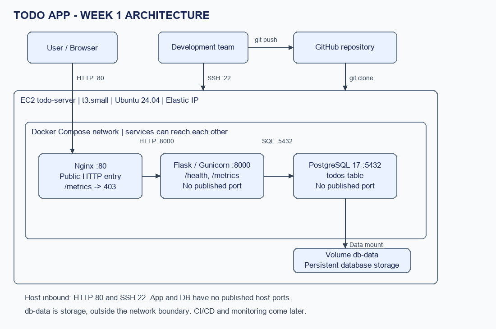

```text
Người dùng
    │ HTTP :80 — todo-devops.duckdns.org
    ▼
EC2 Ubuntu 24.04
    └── Docker Compose (7 service thường trực, chỉ Nginx publish :80)
         ├── Nginx :80  ──────────► Flask/Gunicorn :8000 (DB user: todo_app) ──► PostgreSQL :5432 (volume db-data)
         │      └── /grafana/ ────► Grafana :3000 (volume grafana-data)
         │                              │
         │                              ▼
         └── Mạng nội bộ giám sát: Prometheus :9090 (volume prometheus-data)
                                    ├── scrape 15s ──► app:8000/metrics (todo_db_up, flask_http_request_total)
                                    ├── scrape 15s ──► node-exporter:9100/metrics (/proc, /sys, / read-only)
                                    └── cảnh báo ────► Alertmanager :9093 ──► Discord Webhook (file secret read-only)

GitHub → Actions: test → build → SSH vào EC2 → scripts/deploy.sh:
  kiểm tra config → build app → migrate (1 lần, admin DB) → cấp quyền todo_app → up 7 service → nginx -t/reload → kiểm tra readiness
```

Chỉ Nginx publish cổng 80 ra host. PostgreSQL, Flask, Grafana, Prometheus, Alertmanager và node-exporter không publish cổng trực tiếp ra Internet. `/health` và metric `todo_db_up` kiểm tra kết nối DB thật bằng tài khoản app; Nginx chặn truy cập `/metrics` từ bên ngoài bằng HTTP 403. File nguồn sơ đồ tuần 1: [architecture.drawio](docs/architecture.drawio). Chi tiết bonus xem [thiết kế đồng bộ](docs/offline-first.md).

## 3. Tuần 1 — Server và triển khai đầu tiên

**Mục tiêu:** ứng dụng chạy trên EC2, thêm/xoá công việc được, có sơ đồ kiến trúc, README và minh chứng triển khai.

| Bước | Nội dung | File/kết quả trong dự án |
| --- | --- | --- |
| 1 | Tạo repo, đưa app mẫu lên GitHub | Mã nguồn Flask, template và dependencies trong `app/` |
| 2 | Viết Dockerfile | [app/Dockerfile](app/Dockerfile) |
| 3 | Docker Compose, môi trường và Git ignore | [docker-compose.yml](docker-compose.yml), [.env.example](.env.example), [.gitignore](.gitignore) |
| 4 | Cấu hình Nginx | [nginx/default.conf](nginx/default.conf) |
| 5–7 | Tạo EC2, cài Docker, triển khai và kiểm tra | [scripts/setup-server.sh](scripts/setup-server.sh), minh chứng trong `docs/evidence/week-1/` |
| 8–9 | Sơ đồ kiến trúc và tài liệu | `docs/architecture.*`, README này |

Điểm cần chứng minh khi demo tuần 1:

- Ba service `nginx`, `app`, `db` hoạt động; DB báo healthy.
- Mở ứng dụng qua địa chỉ server, thêm và xoá công việc.
- `/health` trả `{"status":"ok"}`; `/metrics` qua Nginx trả 403.
- Dữ liệu còn sau `docker compose down` rồi `docker compose up -d` **không dùng `-v`**.
- Có sơ đồ, README, lịch sử đóng góp của thành viên và video demo.

## 4. Tuần 2 — Docker và CI/CD

**Mục tiêu:** mỗi lần push/merge vào `main`, GitHub Actions chạy test, build và deploy lên EC2; test lỗi thì không deploy. Docker và volume từ tuần 1 tiếp tục được sử dụng.

### Bước 1 — Test tự động

[tests/test_app.py](tests/test_app.py) chạy với PostgreSQL thật. Bốn kiểm tra nền tảng của tuần 2 gồm:

| Test | Ý nghĩa |
| --- | --- |
| `test_health_ok` | `/health` phản ánh kết nối DB thành công |
| `test_add_then_read_back` | Thêm việc rồi đọc lại từ DB |
| `test_empty_title_is_not_saved` | Tên chỉ có khoảng trắng không tạo dữ liệu |
| `test_delete_removes_todo` | Xoá việc khỏi DB và danh sách |

Bộ test có thêm các trường hợp cho API, migration, phân loại, đồng bộ ngoại tuyến và (từ tuần 3) metric `todo_db_up`, kiểm thử quyền hẹp của `todo_app` cùng kiểm tra tĩnh cấu hình trong [tests/test_week3_config.py](tests/test_week3_config.py). [pytest.ini](pytest.ini) cấu hình import từ thư mục gốc; [requirements-dev.txt](requirements-dev.txt) chứa dependencies kiểm thử.

### Bước 2 — Deploy và mã phiên bản

[scripts/deploy.sh](scripts/deploy.sh) lấy mã commit hiện tại, gán `APP_VERSION`, thực thi quy trình triển khai và kiểm tra sức khoẻ hệ thống. `APP_VERSION` được truyền qua Compose. Xem mã phiên bản ở **footer → Phiên bản**. Nếu chạy Compose mà chưa gán biến này, ứng dụng hiển thị `dev`.

### Bước 3 — GitHub Secrets

Tạo tại **Settings → Secrets and variables → Actions** của repository:

| Secret | Giá trị/công dụng |
| --- | --- |
| `EC2_HOST` | `todo-devops.duckdns.org` — địa chỉ SSH của server |
| `EC2_SSH_KEY` | Toàn bộ private key của key pair đang được server chấp nhận |

Không đưa private key, mật khẩu DB hoặc token DuckDNS vào Git. Khi đổi key pair phải cập nhật `EC2_SSH_KEY`; khi IP đổi, DuckDNS cần được cập nhật đúng để `EC2_HOST` tiếp tục trỏ tới server.

### Bước 4 — Workflow CI/CD

Workflow: [.github/workflows/ci-cd.yml](.github/workflows/ci-cd.yml).

| Job | Công việc | Điều kiện |
| --- | --- | --- |
| `test` | Dựng PostgreSQL 17 tạm, kiểm tra cú pháp shell script, kiểm tra `migrate.py` + `db/app-user.sh` chạy lặp lại được, chạy `pytest -v` (bao gồm kiểm thử app dưới user DB quyền hẹp và kiểm tra cấu hình tĩnh) | Push vào `main` hoặc pull request hướng vào `main` |
| `build` | Build image từ `app/Dockerfile`, kiểm tra `docker compose config`, kiểm tra cấu hình Prometheus/Alertmanager bằng `promtool` và `amtool` | Job `test` thành công |
| `deploy` | SSH vào EC2, pull `main`, chạy `scripts/deploy.sh` | Job `build` thành công và sự kiện là push vào `main` |

```text
Pull request → test → build                  (không deploy)
Push main    → test → build → deploy → kiểm tra /health, API, /metrics (403) và bộ giám sát
                 └─ lỗi: build/deploy bị bỏ qua
```

Job build kiểm tra Dockerfile và cấu hình hệ thống; server build lại image khi deploy, chưa dùng container registry. Nếu `/health` hoặc các thành phần giám sát hỏng sau deploy, pipeline báo lỗi theo từng giai đoạn; script hiện **chưa tự rollback**. Trường hợp test hoặc kiểm tra cấu hình hỏng trước deploy thì bản lỗi không được đưa lên server.

### Bước 5 — Chạy pipeline, kiểm tra dữ liệu và đo thời gian

Sau một thay đổi hợp lệ đã vào `main`, đối chiếu ba job xanh, dòng `Deploy OK`, mã phiên bản trên web và dữ liệu đã có trước lần deploy.

Bảng dưới ghi số liệu tuần 2 lấy từ mục **Total duration** trong GitHub Actions. Ba lần chạy trên `main` dưới đây đều có test, build và deploy thành công; mỗi lần có ảnh riêng, xác định theo mã commit:

| Lần | Mã commit | Total duration | Link lần chạy/ghi chú |
| --- | --- | --- | --- |
| 1 | `6f8fb86` | **1 phút 9 giây** | [Ảnh Actions: test → build → deploy thành công](docs/evidence/week-2/05-main-pipeline-success-69s.png) |
| 2 | `a1f876e` | **1 phút 9 giây** | [Ảnh Actions: lần chạy #15](docs/evidence/week-2/11-main-pipeline-a1f876e-69s.png) |
| 3 | `df43fa1` | **1 phút 9 giây** | [Ảnh Actions: lần chạy #17](docs/evidence/week-2/12-main-pipeline-df43fa1-69s.png) |

### Bước 6 — Demo pipeline chặn lỗi

Theo kịch bản môn học: ghi lại phiên bản đang chạy, tạo một commit demo làm sai kết quả `/health`, rồi theo dõi test đỏ, build/deploy bị skipped và server vẫn giữ phiên bản trước. Sau đó `git revert` **đúng commit demo lỗi**, push và kiểm tra pipeline xanh trở lại. Thực hiện có chủ đích trong buổi demo của nhóm; không để commit lỗi ở trạng thái cuối cùng.

Minh chứng CI/CD cần được ghi từ GitHub Actions và server thực tế, không dùng kết quả test cục bộ thay cho log deploy.

## 5. Tuần 3 — Phân quyền DB, giám sát và Grafana

Các mục 5.1–5.5 mô tả cấu hình mã nguồn cho **Bước 1, Bước 2 và Bước 3** của tuần 3.
Các bước sau dùng: cảnh báo Discord và log (Bước 4–5) theo cấu hình ở `monitoring/` và `docker-compose.yml`; backup/restore (Bước 6) bằng `scripts/backup.sh`, `scripts/restore.sh`, `scripts/db-check.sh`; UFW, SSH và kiểm tra bí mật (Bước 7) làm trực tiếp trên EC2; biên bản sự cố (Bước 8) tại [docs/incidents/2026-11-02-app-down.md](docs/incidents/2026-11-02-app-down.md).
Kết quả chạy thật trên EC2 của cả 8 bước có ảnh ở [mục 13](#13-minh-chứng-tuần-1-2-và-3).

### 5.1. Thứ tự bắt buộc khi nâng cấp server hiện có: Chuẩn bị Bước 1 trước, Merge/Deploy sau

Khi merge nhánh tuần 3 vào `main`, GitHub Actions sẽ tự động SSH vào EC2 và gọi `scripts/deploy.sh`. Script deploy yêu cầu server **đã có sẵn** các biến môi trường mới trong `.env` và file `secrets/discord_webhook_url`.

Để tránh vòng lặp *"phải merge/deploy trước thì trên server mới có script `prepare-step1.sh`, nhưng merge trước khi chuẩn bị thì deploy lại báo lỗi thiếu biến/webhook"*, nhóm thực hiện đúng thứ tự:

1. Mở Pull Request trên GitHub, chờ 2 job `test` và `build` chạy xanh (**chưa bấm Merge**).
2. Trên EC2 (vẫn đang đứng ở nhánh `main` sạch), chạy Bước 1 theo **một trong hai cách không phụ thuộc tên nhánh tạm**:
   - **Cách A — Lấy trực tiếp từ commit của PR qua `FETCH_HEAD` (không đổi nhánh trên EC2):**
     ```bash
     cd ~/devops-todo
     git fetch origin pull/<SO_PR>/head
     PREPARE_GIT_REF=FETCH_HEAD bash <(git show FETCH_HEAD:scripts/prepare-step1.sh)
     ```
   - **Cách B — Copy 2 script lên `/tmp` từ máy cá nhân qua `scp`:**
     ```bash
     # Chạy trên máy cá nhân:
     scp scripts/prepare-step1.sh db/app-user.sh ubuntu@todo-devops.duckdns.org:/tmp/
     # Chạy trên EC2:
     cd ~/devops-todo
     APP_USER_SCRIPT_PATH=/tmp/app-user.sh bash /tmp/prepare-step1.sh
     ```
3. Kiểm tra `git status` trên EC2 vẫn sạch (`working tree clean`), chụp bảng kiểm chứng quyền ở cuối Bước 1, rồi mới bấm **Merge pull request** trên GitHub để tự động deploy.

### 5.2. Bước 1 — Chuẩn bị server và tài khoản PostgreSQL quyền hẹp (`todo_app`)

- [scripts/prepare-step1.sh](scripts/prepare-step1.sh):
  - Tạo bản sao lưu dự phòng toàn bộ database (`pg_dump -Fc` kèm kiểm tra `pg_restore --list`) vào `backups/` (`chmod 600`, nằm ngoài Git) trước khi thay đổi quyền/schema.
  - Giữ nguyên `POSTGRES_USER`, `POSTGRES_PASSWORD`, `POSTGRES_DB` của volume hiện tại; bổ sung `APP_DB_USER`, `APP_DB_PASSWORD`, `GRAFANA_ADMIN_PASSWORD`, `GRAFANA_ROOT_URL` khi thiếu; **báo lỗi rõ nếu biến đã khai báo nhưng để rỗng** và **không ghi đè âm thầm** mật khẩu hoặc webhook hợp lệ đã có.
  - Lưu Discord webhook tại `secrets/discord_webhook_url` với quyền thư mục `secrets` là `0750` (`root:65534`) và file là `0640` (`root:65534`), khớp với `USER nobody` (`65534:65534`) của image `prom/alertmanager:v0.28.1` mà không mở quyền đọc cho mọi user trên host.
- [db/app-user.sh](db/app-user.sh):
  - Trích dẫn định danh và mật khẩu qua `\getenv` + `set_config` + `format('%I'/'%L')` của PostgreSQL, tắt shell tracing (`set +x`), chạy lặp lại không lỗi.
  - Thu hồi quyền kế thừa từ `PUBLIC` trên database/schema/bảng/sequence, thu hồi mọi membership role quản trị, đảm bảo `todo_app` không sở hữu bảng/schema/database và không có `SUPERUSER`, `CREATEDB`, `CREATEROLE`.

| Đối tượng | Quyền cấp cho `todo_app` | Ghi chú |
| --- | --- | --- |
| Database (`POSTGRES_DB`) | `CONNECT` | Thu hồi `CREATE`, `TEMP` từ `PUBLIC` và `todo_app` |
| Schema `public` | `USAGE` | Không cấp `CREATE` (chặn `CREATE TABLE`) |
| `todos` | `SELECT, INSERT, UPDATE, DELETE` | Cần `UPDATE` cho đồng bộ `/api/operations` (`update`), `/complete/<id>` và xoá nhãn phân loại |
| `todos_id_seq` | `USAGE` | Phục vụ sinh `id` tuần tự khi `INSERT INTO todos` |
| `todo_operations` | `SELECT, INSERT` | Nhật ký chống gửi trùng `op_id` (không cho sửa/xoá lịch sử thao tác) |
| `todo_tombstones` | `SELECT, INSERT` | Ghi nhận công việc đã xoá |
| `todo_categories` | `SELECT, INSERT, DELETE` | Tương thích dữ liệu/hàng đợi phân loại |
| `todo_category_tombstones` | `SELECT, INSERT` | Ghi nhận phân loại đã xoá |

### 5.3. Bước 2 — Tách migration, cấu hình 7 service và quy trình `scripts/deploy.sh`

- **Metric ứng dụng ([app/app.py](app/app.py)):** Bổ sung `db_ok()` thực thi `SELECT 1` bằng chính kết nối của `APP_DB_USER`, gắn với Prometheus `Gauge` `todo_db_up` (`1` khi kết nối thành công, `0` khi lỗi DB) được gọi mỗi lần scrape `/metrics`. Giữ nguyên 1 Gunicorn worker, `/health` và toàn bộ API ngoại tuyến.
- **Tách migration khỏi entrypoint ([app/entrypoint.sh](app/entrypoint.sh)):** Container `app` chạy thường trực chỉ thực thi `exec gunicorn ...` dưới tài khoản `APP_DB_USER`, không nhận mật khẩu quản trị và không chạy DDL lúc khởi động lại.
- **Mount thư mục cấu hình read-only ([docker-compose.yml](docker-compose.yml)):** Nginx (`./nginx:/etc/nginx/conf.d:ro`), Prometheus (`./monitoring/prometheus:/etc/prometheus:ro`), Alertmanager (`./monitoring/alertmanager:/etc/alertmanager:ro` và `./secrets:/etc/alertmanager-secrets:ro`) cùng Grafana đều mount theo **thư mục** read-only thay vì mount lẻ từng file, tránh hiện tượng container giữ inode cũ sau `git pull`.
- **Thứ tự thực thi của [scripts/deploy.sh](scripts/deploy.sh) (giai đoạn `a` → `g`):**
  1. `[a/g]` Kiểm tra biến bắt buộc trong `.env` (kèm điều kiện `APP_DB_USER != POSTGRES_USER`), kiểm tra `docker compose config`, `promtool check config`, `amtool check-config` và quyền đọc file webhook của Alertmanager.
  2. `[b/g]` Build image `app` mới và chờ PostgreSQL `pg_isready`.
  3. `[c/g]` Chạy container một lần từ image `app` với tài khoản quản trị (`POSTGRES_USER`/`POSTGRES_PASSWORD`) để thực thi `python migrate.py`. Nếu lỗi thì dừng deploy ngay trước khi khởi động `app` mới.
  4. `[d/g]` Chạy `db/app-user.sh` cấp lại quyền tối thiểu cho `APP_DB_USER`. Nếu lỗi thì dừng deploy và báo đúng giai đoạn.
  5. `[e/g]` Khởi động/cập nhật đủ 7 service (`app` chỉ nhận `APP_DB_USER`/`APP_DB_PASSWORD`).
  6. `[f/g]` Kiểm tra `nginx -t` trước khi `nginx -s reload`.
  7. `[g/g]` Chờ `/health` và `/api/tasks` phản hồi 200, xác nhận `/metrics` qua Nginx trả 403, gọi đồng bộ `POST /-/reload` trên Prometheus và Alertmanager, đối chiếu trực tiếp metric `prometheus_config_last_reload_successful == 1`, `alertmanager_config_last_reload_successful == 1`, danh sách 3 luật cảnh báo (`AppDown`, `DatabaseDown`, `HighMemory`) trong `/api/v1/rules`, metric `node-exporter`, `/grafana/api/health` và đủ `7/7` service ở trạng thái `running`.

### 5.4. Bước 3 — Provisioning Grafana và lưu ý quản lý Dashboard JSON

- Grafana phục vụ tại `http://todo-devops.duckdns.org/grafana/` với `GF_SERVER_ROOT_URL` có dấu `/` cuối, `GF_SERVER_SERVE_FROM_SUB_PATH=true`, `GF_USERS_ALLOW_SIGN_UP=false`; Nginx chuyển tiếp nguyên đường dẫn `/grafana/` và nâng cấp kết nối WebSocket cho `/grafana/api/live/`.
- Datasource Prometheus được provision tự động tại [monitoring/grafana/provisioning/datasources/prometheus.yml](monitoring/grafana/provisioning/datasources/prometheus.yml) (`url: http://prometheus:9090`, UID cố định `prometheus`).
- Hai dashboard được provision tự động qua [monitoring/grafana/provisioning/dashboards/dashboards.yml](monitoring/grafana/provisioning/dashboards/dashboards.yml):
  1. **Todo App** ([monitoring/grafana/dashboards/todo-app.json](monitoring/grafana/dashboards/todo-app.json)):
     - `App`: `up{job="app"}` (Stat instant query: `1` = `UP`, `0` = `DOWN`, mất dữ liệu = `No data`).
     - `Database`: `todo_db_up{job="app"}` (Stat instant query + phép tính `last`: khi `app` dừng làm mất mẫu scrape sẽ hiển thị `No data` màu cảnh báo, không lấy mẫu cũ để báo giả thành `UP`).
     - `Request/giây`: `sum(rate(flask_http_request_total{job="app"}[1m]))` (Time series).
  2. **EC2 Server Resources** ([monitoring/grafana/dashboards/server-host.json](monitoring/grafana/dashboards/server-host.json)): trạng thái `up{job="node"}`, đồng hồ và đồ thị thời gian cho CPU host (%), RAM host (%) và ổ đĩa gốc `/` của máy chủ EC2.
- **Lưu ý về sửa dashboard trên giao diện web vs lưu trong Git:** Thư mục `/etc/grafana/dashboards` trong container được mount ở chế độ **read-only (`:ro`)** từ `monitoring/grafana/dashboards/` trong repo. Mặc dù `allowUiUpdates: true` cho phép thử chỉnh sửa bố cục tạm thời trên trình duyệt, **Grafana không tự ghi thay đổi ngược về file JSON hay commit vào Git**, và thay đổi trên UI có thể mất khi tạo lại volume/container. Nếu muốn lưu vĩnh viễn một chỉnh sửa dashboard (hoặc import thêm dashboard cộng đồng như ID `1860`), cần bấm **Share → Export → Save to file** và commit file JSON vào `monitoring/grafana/dashboards/`.

### 5.5. Checklist kiểm chứng và minh chứng cần thu thập cho Bước 1–3

*(Trạng thái dưới đây dùng để nhóm kiểm tra khi chạy thực tế trên GitHub Actions và EC2; chỉ đánh dấu sau khi đã có kết quả và ảnh chụp thật, che toàn bộ mật khẩu và URL webhook).*

- [ ] **Bước 1 — Backup & Biến môi trường:** Có file backup dự phòng trong `backups/`; `.env` quyền `600`; `secrets/discord_webhook_url` quyền `root:65534` (`640`), container Alertmanager đọc được file mà không in nội dung bí mật.
- [ ] **Bước 1 — Phân quyền DB:** Ảnh/kết quả truy vấn chứng minh `todo_app` không có `rolsuper`/`rolcreatedb`/`rolcreaterole`, không sở hữu bảng, có quyền DML đúng thiết kế và không có quyền `CREATE` trên schema `public`.
- [ ] **Bước 2 — CI & Triển khai 7 service:** Pipeline GitHub Actions xanh (`test` → `build` → `deploy`); `docker compose ps` trên EC2 có đủ 7 service `Up` và chỉ `nginx` mở cổng `80`.
- [ ] **Bước 2 — Vận hành bằng user quyền hẹp:** `/health` trả `200`, `/metrics` qua Nginx trả `403`, thêm/xoá và đồng bộ công việc trên UI-basic hoạt động bình thường; `docker compose restart app` không chạy DDL và không báo lỗi `must be owner`; cấu hình log `json-file` `10m` × `3` được áp dụng.
- [ ] **Bước 3 — Grafana Datasource & Dashboards:** Đăng nhập được `/grafana/`, datasource `Prometheus` (`uid: prometheus`) truy vấn thành công; có ảnh minh chứng dashboard **EC2 Server Resources** (CPU, RAM, ổ đĩa host) và dashboard **Todo App** (`App`, `Database`, `Request/giây`).

## 6. Phần bonus — Giao diện và quản lý công việc

**Phụ trách thiết kế/cải tiến UI: Ngô Tấn Đức.** Giao diện hiện tại dùng bố cục trong `todo-clean.zip`: một cột giữa màn hình, nền sáng, màu nhấn xanh, responsive và không dùng thư viện/CDN. Phần này không thay thế nhiệm vụ tuần 1–2.

- Thêm công việc tối đa 200 ký tự, đếm ký tự và chặn tên rỗng/toàn khoảng trắng.
- Tìm kiếm tiếng Việt có/không dấu, phím `/`, xoá nhanh từ khoá; sắp xếp cũ nhất, mới nhất hoặc tên A–Z.
- Danh sách chỉ hiện tên công việc, dấu chấm và nút xoá. Có trạng thái trống/không tìm thấy, xử lý tiêu đề dài và hộp thoại xác nhận xoá.
- Chuyển sáng/tối, nhớ lựa chọn trên trình duyệt. Footer hiển thị `APP_VERSION`; trạng thái kết nối và nút đồng bộ nằm gọn cuối danh sách.
- IndexedDB giữ snapshot và hàng đợi thêm/xoá. Vẫn dùng được trên trang đang mở khi mất mạng; tự gửi lại khi kết nối phục hồi và không tạo trùng khi mất phản hồi.
- Form thêm/xoá vẫn gửi POST chuẩn khi tắt JavaScript và máy chủ có kết nối.

Sidebar, lịch, ưu tiên, tiến độ, phân loại và đánh dấu hoàn thành đã được bỏ khỏi giao diện theo mẫu ZIP. Schema/API và metadata cũ vẫn được giữ để bảo toàn dữ liệu và xử lý các thao tác đang chờ từ bản trước; giao diện mới không tự xoá dữ liệu cũ.

Ứng dụng dùng danh sách chung, chưa có tài khoản riêng. Bản Flask gọi API thật, lưu PostgreSQL. Bản HTML xem thử là bản cục bộ riêng và ghi rõ lưu trên thiết bị, không kết nối EC2.

## 7. Cấu trúc repository

```text
.github/workflows/ci-cd.yml   # test → build → deploy (chỉ deploy khi push main)
app/
  app.py                      # Form, API, health, metric todo_db_up và Service Worker
  categories.py               # Kiểm tra và lưu phân loại
  migrate.py                  # Migration giữ dữ liệu hiện có (chạy bằng user quản trị khi deploy)
  schema.sql                  # Schema chuẩn
  Dockerfile
  entrypoint.sh               # Chỉ khởi chạy Gunicorn (1 worker, 4 threads)
  requirements.txt
  templates/index.html
  static/
    app.js                    # UI, IndexedDB và đồng bộ
    style.css
    service-worker.js
  .dockerignore
db/
  init.sql                    # Schema khởi tạo cho DB mới; khớp app/schema.sql
  app-user.sh                 # Tạo và cấp quyền tối thiểu cho tài khoản DB ứng dụng (idempotent)
monitoring/
  prometheus/
    prometheus.yml            # Scrape 15s cho prometheus, app và node-exporter
    alerts.yml                # Luật cảnh báo AppDown, DatabaseDown, HighMemory
  alertmanager/
    alertmanager.yml          # Route sang Discord qua webhook_url_file + send_resolved
  grafana/
    provisioning/
      datasources/prometheus.yml
      dashboards/dashboards.yml
    dashboards/
      todo-app.json           # Dashboard App, Database, Request/giây
      server-host.json        # Dashboard CPU, RAM, ổ đĩa host EC2
nginx/default.conf            # Chặn /metrics, proxy /grafana/ (+ WS) và proxy / sang app
scripts/
  setup-server.sh             # Bootstrap EC2 mới (tương thích tuần 3, yêu cầu webhook trước khi hoàn tất)
  prepare-step1.sh            # Chuẩn bị Bước 1 trên EC2 trước khi merge/deploy cấu hình tuần 3
  deploy.sh                   # Kiểm tra config → migrate quản trị → cấp quyền app → up 7 service → kiểm tra readiness
  backup.sh                   # Sao lưu DB ra backups/todo-*.sql.gz, giữ 7 bản mới nhất
  restore.sh                  # Khôi phục DB từ một file backup (ghi đè, hỏi xác nhận trước)
  db-check.sh                 # In số việc và mã md5 của bảng todos để so trước/sau restore
tests/
  test_app.py                 # Pytest tích hợp với PostgreSQL thật (admin migration + least-privilege app user)
  test_week3_config.py        # Pytest kiểm tra tĩnh cấu hình, dashboard provisioning và unit test metric
  offline.test.cjs            # Logic đồng bộ client với Node.js
docs/
  architecture.drawio
  architecture.png
  evidence/                   # Ảnh và video minh chứng, mỗi tuần một thư mục: week-1/, week-2/, week-3/
  incidents/                  # Biên bản sự cố
  offline-first.md
  production-sync.md
.env.example
.gitattributes
.gitignore
docker-compose.yml
pytest.ini
requirements-dev.txt
README.md
```

## 8. Chạy trên máy cá nhân

Cần Git, Docker Engine và Docker Compose plugin. Trên Windows, dùng Docker Desktop với Linux containers.

```bash
git clone https://github.com/ericphan2545/devops-final.git
cd devops-final
```

Tạo `.env` từ `.env.example` nếu chưa có (Linux/macOS/Git Bash):

```bash
test -f .env || cp .env.example .env
```

PowerShell:

```powershell
if (-not (Test-Path -LiteralPath .env)) { Copy-Item .env.example .env }
```

Mở `.env`, đặt mật khẩu riêng cho `POSTGRES_PASSWORD`, `APP_DB_PASSWORD`, `GRAFANA_ADMIN_PASSWORD` (bảo đảm `APP_DB_USER` khác `POSTGRES_USER`); khi chạy cục bộ có thể đặt `GRAFANA_ROOT_URL=http://localhost/grafana/`. Đồng thời tạo file `secrets/discord_webhook_url` chứa URL Discord webhook thử nghiệm hợp lệ (ngoài Git) để Alertmanager nạp được cấu hình.

Trên Linux/macOS/WSL2, có thể chạy trực tiếp quy trình đầy đủ qua script deploy:

```bash
bash scripts/deploy.sh
docker compose ps
```

Mở [http://localhost](http://localhost) cho ứng dụng Todo và [http://localhost/grafana/](http://localhost/grafana/) cho Grafana.

## 9. Triển khai EC2 và DuckDNS

### Dựng server mới bằng User data

Dùng [scripts/setup-server.sh](scripts/setup-server.sh) trên EC2 Ubuntu 24.04. Khi dán vào ô **User data**, có thể điền `DUCKDNS_TOKEN` và `DISCORD_WEBHOOK_URL` trực tiếp trên AWS Console; trong Git luôn giữ hai biến này rỗng.

- Script cài Docker/Compose, cấu hình cron cập nhật DuckDNS (nếu có token), clone repo vào `/home/ubuntu/devops-todo`, sinh `.env` với mật khẩu ngẫu nhiên (`chmod 600`) và tạo thư mục `secrets` (`0750`, `root:65534`), không bật shell tracing trên các đoạn xử lý bí mật.
- **Nếu đã điền `DISCORD_WEBHOOK_URL` hợp lệ:** script ghi `secrets/discord_webhook_url` (`0640`, `root:65534`) rồi gọi `scripts/deploy.sh` để chạy migration, cấp quyền `todo_app`, khởi động đủ 7 service và chỉ in `SETUP XONG` khi mọi kiểm tra health/monitoring đạt.
- **Nếu chưa điền `DISCORD_WEBHOOK_URL`:** script dừng lại với hướng dẫn rõ ràng trong `/var/log/setup-server.log` (không báo giả `SETUP XONG`), chờ quản trị viên SSH vào chạy `bash scripts/prepare-step1.sh` rồi `bash scripts/deploy.sh`.

Security Group cần cho phép HTTP 80 và SSH 22 từ nguồn quản trị/deploy phù hợp. Repo hiện phục vụ HTTP, chưa cấu hình chứng chỉ HTTPS.

### Nâng cấp và deploy thủ công trên server đang hoạt động

Với server đang chạy từ tuần trước, luôn hoàn tất **Bước 1** (xem mục [5.1](#51-thứ-tự-bắt-buộc-khi-nâng-cấp-server-hiện-có-chuẩn-bị-bước-1-trước-mergedeploy-sau)) trước khi cập nhật nhánh `main`. Sau khi code đã merge vào `main` và Bước 1 đã sẵn sàng:

```bash
cd ~/devops-todo
git status
git switch main
git pull --ff-only origin main
bash scripts/deploy.sh
```

Nếu server có thay đổi cục bộ, xử lý chúng trước khi pull; không ghi đè hoặc reset mù. Trong CI, workflow chỉ gọi `bash scripts/deploy.sh` (không gọi script tương tác `prepare-step1.sh`).

## 10. Kiểm thử và kiểm tra vận hành

### Kiểm tra hệ thống trên server chạy Compose

```bash
docker compose ps
curl --fail http://localhost/health
curl --fail http://localhost/api/tasks
curl -I http://localhost/metrics
curl --fail http://localhost/grafana/api/health
docker compose logs --tail 50 app
docker compose logs --tail 50 nginx
```

Kết quả mong đợi: 7 service đều `Up` (chỉ `nginx` mở cổng `80`), `/health` trả `{"status":"ok"}`, `/metrics` qua Nginx trả `403`, `/grafana/api/health` trả `200`. Trong PowerShell dùng `curl.exe` nếu `curl` đang là alias.

### Kiểm tra tĩnh (không cần Docker hay PostgreSQL đang chạy)

```bash
python -m pytest tests/test_week3_config.py -v
node tests/offline.test.cjs
```

### Chạy test tích hợp cục bộ với PostgreSQL riêng

Cần Python và PostgreSQL; lệnh dưới tạo DB kiểm thử bằng Docker, không trỏ test vào DB đang phục vụ người dùng:

```bash
docker run -d --name todo-test-db -p 127.0.0.1:55432:5432 -e POSTGRES_USER=todo -e POSTGRES_PASSWORD=testpass -e POSTGRES_DB=todo_test postgres:17
python -m pip install -r requirements-dev.txt
docker exec todo-test-db pg_isready -U todo -d todo_test
```

Chờ DB ready, rồi trong PowerShell:

```powershell
$env:DB_HOST = "localhost"
$env:PGPORT = "55432"
$env:DB_NAME = "todo_test"
$env:DB_USER = "todo"
$env:DB_PASSWORD = "testpass"
python -m pytest -v
```

Linux/macOS/Git Bash:

```bash
DB_HOST=localhost PGPORT=55432 DB_NAME=todo_test DB_USER=todo DB_PASSWORD=testpass python -m pytest -v
```

Fixture kiểm thử dùng tài khoản quản trị tạo schema ngẫu nhiên riêng, chạy migration, tạo role ứng dụng quyền hẹp tạm thời cho phiên test để thực thi toàn bộ API/form/metric dưới quyền hẹp, rồi thu dọn schema và role khi kết thúc.

## 11. Dữ liệu, migration và đồng bộ

### Phân biệt dựng database mới và nâng cấp volume `db-data` cũ

- **Dựng database mới (volume `db-data` rỗng lần đầu):** PostgreSQL tự thực thi các file trong `/docker-entrypoint-initdb.d/` theo thứ tự bảng chữ cái: `10-init.sql` ([db/init.sql](db/init.sql)) tạo đầy đủ 5 bảng và dữ liệu phân loại mặc định trước, sau đó `20-app-user.sh` ([db/app-user.sh](db/app-user.sh)) tạo tài khoản `APP_DB_USER` và cấp quyền tối thiểu.
- **Nâng cấp volume `db-data` đã có dữ liệu:** PostgreSQL **bỏ qua** `/docker-entrypoint-initdb.d/` khi thư mục dữ liệu đã được khởi tạo. Đồng thời [app/entrypoint.sh](app/entrypoint.sh) hiện **chỉ chạy Gunicorn** bằng tài khoản quyền hẹp `APP_DB_USER` (không còn chạy `migrate.py` trong entrypoint). Thay vào đó, mỗi lần chạy [scripts/deploy.sh](scripts/deploy.sh), hệ thống khởi chạy một container ngắn hạn từ image `app` với tài khoản quản trị `POSTGRES_USER` để chạy [app/migrate.py](app/migrate.py), tiếp theo chạy [db/app-user.sh](db/app-user.sh) cấp lại quyền cho `APP_DB_USER`, rồi mới khởi động container `app` phục vụ người dùng.
- `db-data` giữ dữ liệu khi thay hoặc tạo lại container trên cùng host, nhưng volume không thay thế bản sao lưu khi host/ổ đĩa gặp sự cố. **Không dùng `docker compose down -v`** khi nâng cấp UI, schema hay cấu hình giám sát vì lệnh `-v` sẽ xoá toàn bộ volume dữ liệu.
- Sao lưu DB trước thay đổi lớn. Đổi `POSTGRES_PASSWORD` trong `.env` không tự đổi mật khẩu quản trị đã lưu bên trong volume DB cũ.

### Ngoại tuyến và chống gửi trùng

Thao tác được ghi vào IndexedDB trước khi báo đã lưu. Mỗi công việc và thao tác có UUID ổn định; server lưu kết quả thao tác trong cùng giao dịch với thay đổi dữ liệu. Khi mất phản hồi, client gửi lại cùng `op_id` và server trả kết quả đã có.

Chỉ xoá thao tác khỏi hàng đợi sau xác nhận hợp lệ. Xoá thắng cập nhật cũ nhờ tombstone. Hai thiết bị sửa cùng trường dùng giá trị server nhận sau cùng; đây chưa phải hệ thống cộng tác có lịch sử phiên bản. Phân loại mới được gửi trước công việc tham chiếu tới nhóm đó. Xoá nhóm được ghi vào hàng đợi `category_delete`; server giữ bản ghi trong `todo_category_tombstones` và `/api/tasks` trả `deletedCategories`. Thao tác cũ từ thiết bị khác vẫn lưu được nội dung công việc nhưng không gắn lại nhãn đã xoá.

### Giới hạn cần biết

- Service Worker cần **HTTPS hoặc localhost**, và trang phải từng tải/cache thành công. Với HTTP qua IP hoặc DuckDNS, trang đang mở vẫn lưu thao tác ngoại tuyến, nhưng chưa bảo đảm tải lại toàn bộ trang khi mất mạng.
- Cache dành cho trang, CSS, JS; không cache API, `/health`, `/metrics` hoặc POST.
- Chưa có đồng bộ nền khi đóng hẳn trình duyệt; ứng dụng thử lại khi mở/trở lại tab, có mạng và theo chu kỳ khi đang hoạt động.
- Bộ nhớ trình duyệt gắn với origin. Chuyển từ IP sang DuckDNS hoặc từ HTTP sang HTTPS tạo vùng lưu trữ khác; đồng bộ hết thay đổi ở địa chỉ cũ trước khi chuyển.

Chi tiết: [docs/offline-first.md](docs/offline-first.md) và [docs/production-sync.md](docs/production-sync.md).

## 12. Endpoint và form

| Endpoint | Vai trò |
| --- | --- |
| `GET /` | Trang công việc dựng từ dữ liệu PostgreSQL |
| `POST /add` | Thêm công việc qua form |
| `POST /complete/<id>` | Hoàn thành/huỷ hoàn thành |
| `POST /delete/<id>` | Xoá công việc |
| `POST /categories/add` | Tạo phân loại qua form |
| `POST /categories/delete` | Xoá phân loại qua form; giữ công việc |
| `GET /health` | Kiểm tra kết nối DB thật (`db_ok()`) |
| `GET /metrics` | Metrics Prometheus của app (`todo_db_up`, `flask_http_request_total`, ...); chỉ đọc trong mạng nội bộ, bị Nginx chặn 403 từ bên ngoài |
| `GET /api/tasks` | Công việc và phân loại đã lưu |
| `GET /api/categories` | Danh sách phân loại |
| `POST /api/operations` | Thao tác `create`, `update`, `delete`, `category_create`, `category_delete` |
| `GET /service-worker.js` | Bộ nhớ trang ngoại tuyến, scope `/` |
| `GET /grafana/` | Giao diện Grafana qua reverse proxy Nginx (kèm WebSocket `/grafana/api/live/`) |

Các endpoint hoàn thành, lịch/metadata và phân loại được giữ để tương thích dữ liệu cũ; UI tối giản hiện chỉ dùng thêm, đọc và xoá công việc.

API, health và endpoint Service Worker dùng `Cache-Control: no-store`. Một `op_id` dùng lại với payload khác nhận HTTP 409. Tên phân loại được chuẩn hoá khi kiểm tra trùng; server trả ID nhóm đã có nếu hai thiết bị tạo cùng tên. Client cập nhật ID nhóm trong các thao tác chưa gửi trước khi tiếp tục đồng bộ. Phiên bản này hỗ trợ tạo và xoá nhóm, chưa hỗ trợ sửa tên. Xoá nhóm gỡ nhãn khỏi mọi công việc trong cùng giao dịch và lưu bản ghi xoá; khi migration chạy lại, nhóm đã xoá không tự được tạo lại.

## 13. Minh chứng tuần 1, 2 và 3

### Tuần 1 — File đã lưu trong repo

| Nội dung | Minh chứng |
| --- | --- |
| EC2 và Security Group | [EC2 Running](docs/evidence/week-1/ec2-running.png), [Security Group](docs/evidence/week-1/security-group.png) |
| Docker và Compose | [Phiên bản Docker](docs/evidence/week-1/docker-version.png), [Container Up/healthy](docs/evidence/week-1/compose-up-ps.png) |
| Health và giới hạn metrics | [Health/metrics](docs/evidence/week-1/health-metrics.png), [Truy cập health](docs/evidence/week-1/health-public-ip.png) |
| Ứng dụng và dữ liệu | [Giao diện bản trước](docs/evidence/week-1/app-web.png), [Down/up giữ dữ liệu](docs/evidence/week-1/compose-down-up.png) |
| Sơ đồ và video | [Sơ đồ PNG](docs/architecture.png), [File draw.io](docs/architecture.drawio), [Video demo](docs/evidence/week-1/demo.mp4) |

Các ảnh/video trên thuộc bản triển khai trước. Chụp bổ sung khi cần chứng minh giao diện bonus hoặc trạng thái server sau bản cập nhật.

### Tuần 2 — Minh chứng thực hiện

Các ảnh dưới đây ghi lại quá trình kiểm thử, cấu hình Secrets và chạy CI/CD của nhóm tại thời điểm chụp. Ảnh được lưu tại [docs/evidence/week-2](docs/evidence/week-2/); không bao gồm giá trị private key hay GitHub Secrets.

| Nội dung | Kết quả thể hiện trong ảnh |
| --- | --- |
| Cấu hình Secrets | Đã khai báo `EC2_HOST` và `EC2_SSH_KEY` |
| Kiểm thử cục bộ | Bốn test nền tảng đạt, `4 passed in 1.32s`; đây là kết quả cục bộ của bản tại thời điểm chụp |
| Kiểm tra pull request | PR #12, #13 và #14 có test/build xanh; deploy được bỏ qua đúng điều kiện chỉ deploy khi push `main` |
| Pipeline trên `main` | Ba commit `6f8fb86`, `a1f876e`, `df43fa1`: test → build → deploy xanh; Total duration mỗi lần **1 phút 9 giây** |
| Triển khai EC2 | Log có `Deploy OK: phiên bản 6f8fb86` |
| Demo lỗi và hoàn tác | PR #16: commit lỗi `7eb15fd` làm test đỏ, build bị bỏ qua; commit revert `50734b6` đưa test/build về xanh |

<details>
<summary>1. GitHub Actions Secrets</summary>

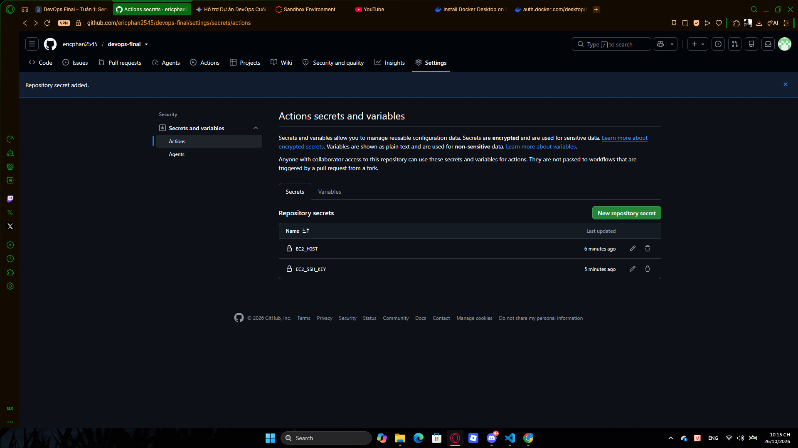

</details>

<details>
<summary>2. Bốn bài kiểm thử với PostgreSQL trên máy cá nhân</summary>

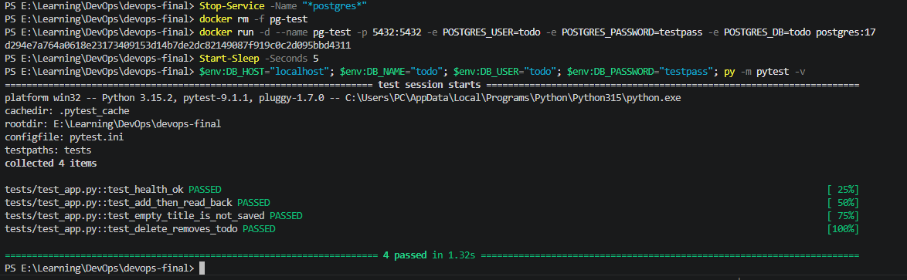

Ảnh này minh chứng chạy test cục bộ; không thay thế log pytest trong job `test` của GitHub Actions.

</details>

<details>
<summary>3. Pull request hợp lệ: test và build thành công</summary>

PR #12 thay đổi nội dung sidebar:

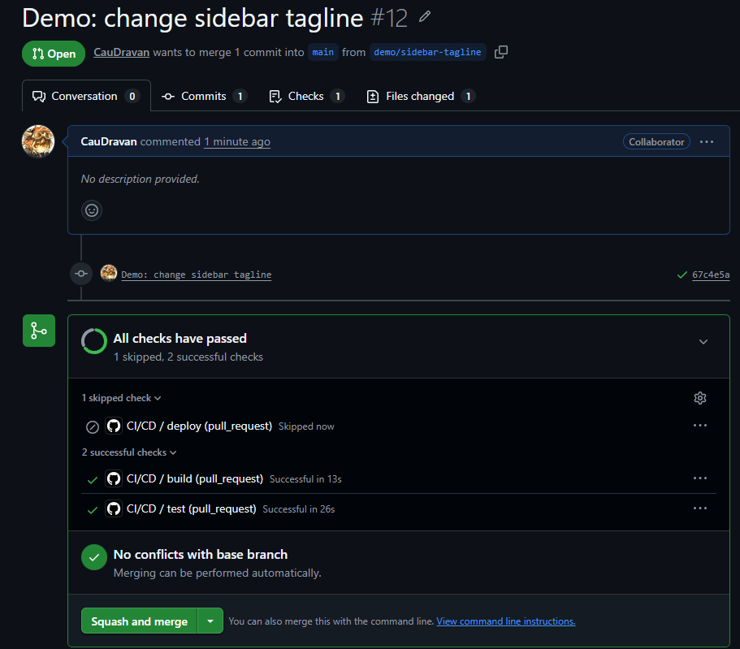

PR #13 cập nhật README:

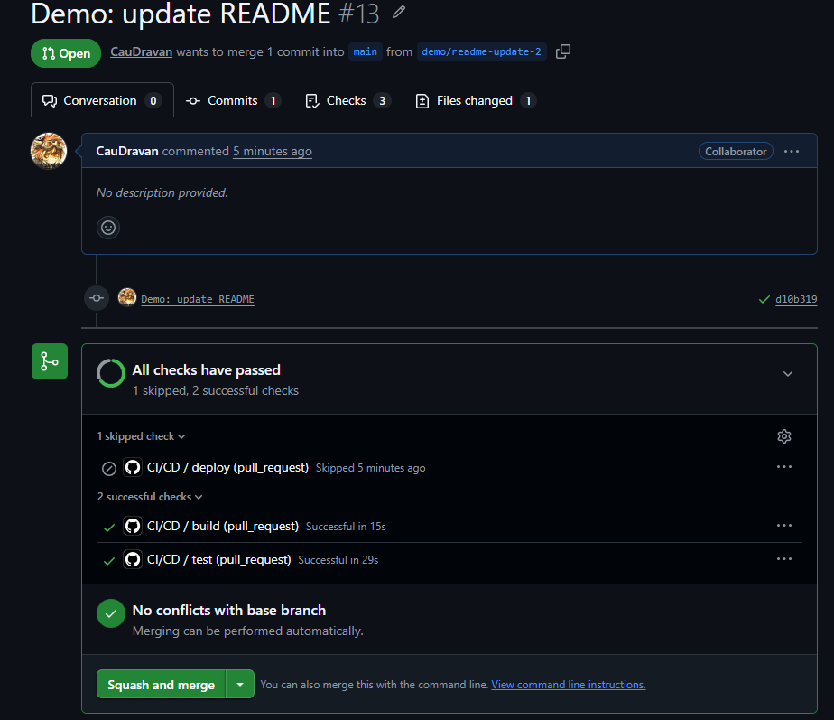

PR #14 cập nhật README lần thứ ba:

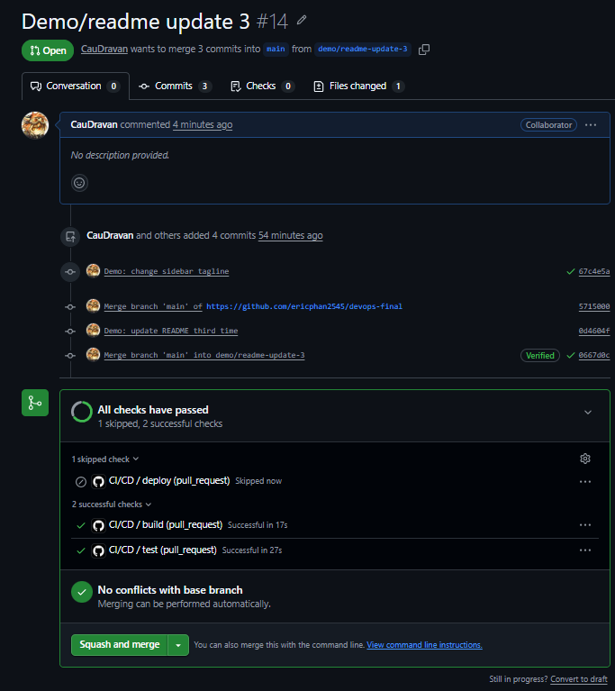

Job deploy trên pull request bị bỏ qua theo cấu hình workflow; chỉ push vào `main` mới triển khai.

</details>

<details>
<summary>4. Pipeline trên main và triển khai EC2 thành công</summary>

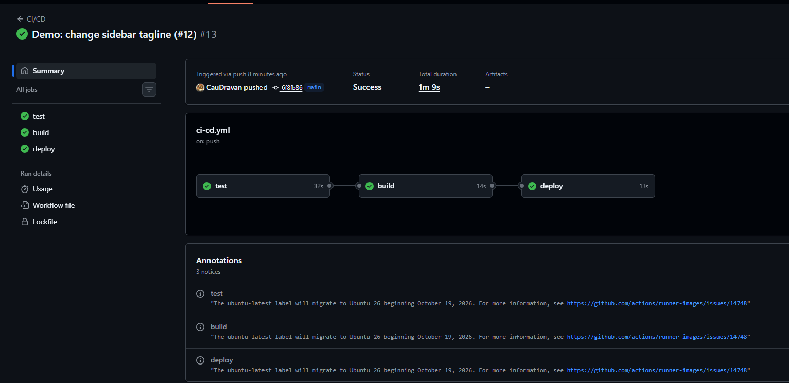

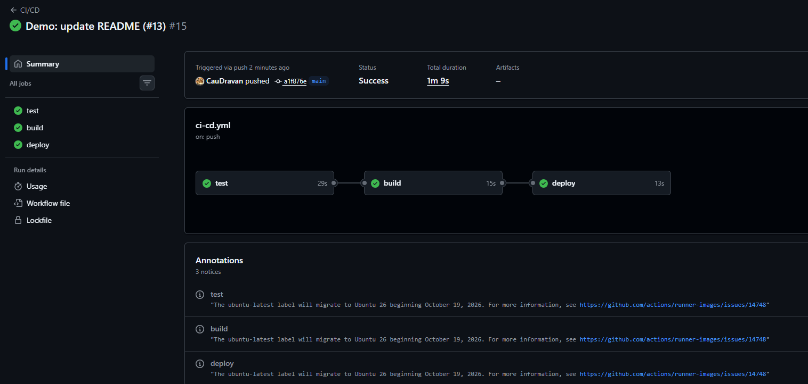

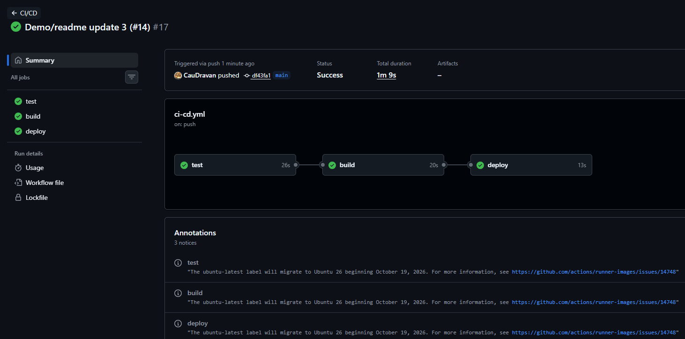

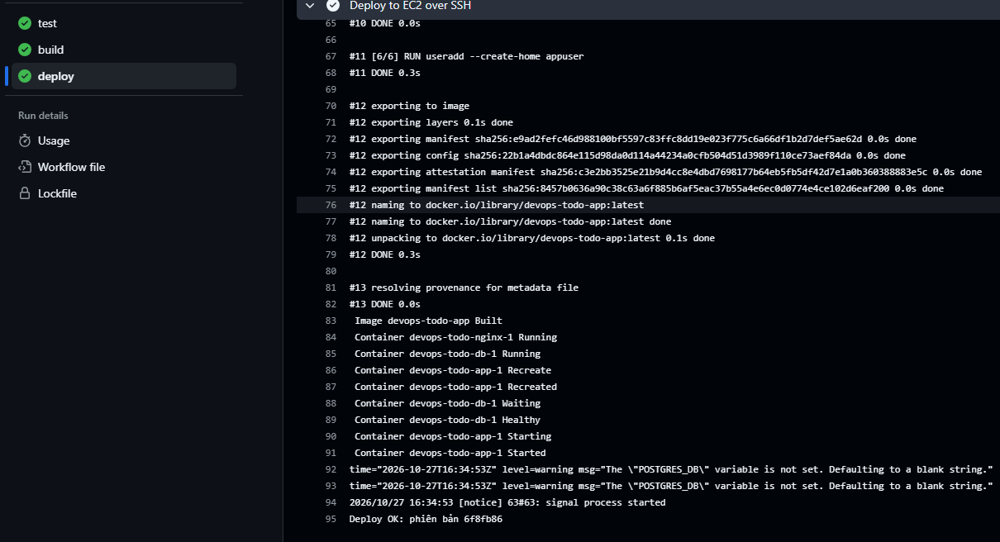

Log có cảnh báo biến `POSTGRES_DB` chưa được thiết lập trong ngữ cảnh lệnh; cần kiểm tra cấu hình nếu cảnh báo còn xuất hiện ở lần triển khai tiếp theo. Dòng `Deploy OK` là kết quả được ghi trong ảnh, chưa thay thế minh chứng đối chiếu phiên bản và dữ liệu trên web.

</details>

<details>
<summary>5. Test lỗi chặn build</summary>

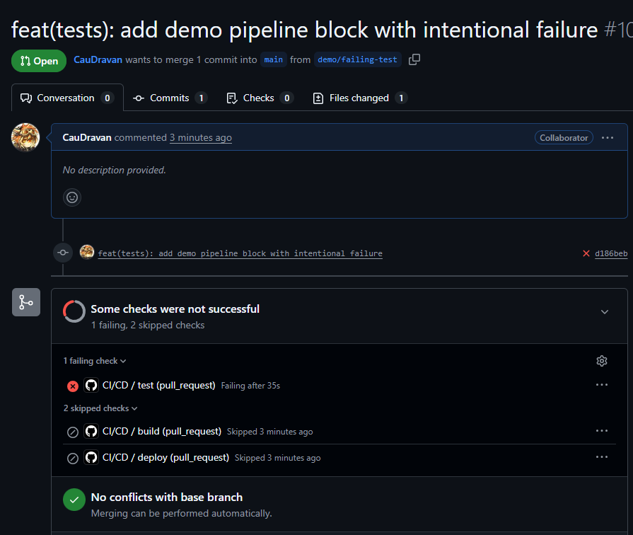

</details>

<details>
<summary>6. Demo làm hỏng health check và revert trên PR 16</summary>

Commit `7eb15fd` làm test thất bại; build bị bỏ qua:

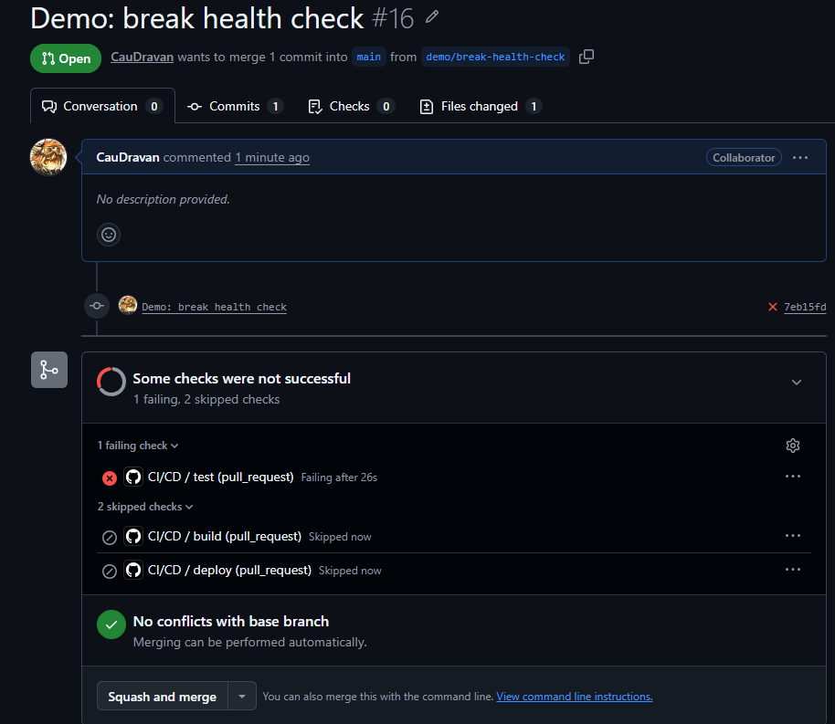

Sau commit `50734b6` — `Revert "Demo: break health check"`, test và build thành công trở lại:

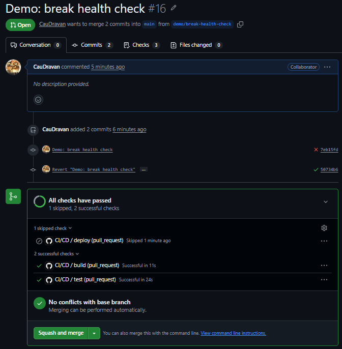

Hai ảnh ghi lại chu kỳ lỗi → revert trên **pull request**. Deploy trên PR vốn bị bỏ qua theo điều kiện workflow; bộ ảnh này chưa chứng minh một lần push `main` lỗi và phiên bản EC2 được giữ nguyên.

</details>

**Minh chứng cần bổ sung để hoàn tất yêu cầu tuần 2:**

- Log pytest bên trong job `test` của GitHub Actions.
- Web hiển thị mã commit vừa triển khai và dữ liệu cũ còn sau deploy.
- Kịch bản test lỗi trên `main` giữ nguyên phiên bản server, kèm lần chạy xanh sau revert theo yêu cầu môn học.
- Video push → pipeline → web cập nhật.

Ảnh log triển khai và ảnh revert được gửi lặp lại chỉ hiển thị một lần, không tính thành các lần chạy khác nhau. Ảnh chụp phần README cũ là tài liệu tham chiếu, không dùng làm minh chứng CI/CD.

### Tuần 3 — Minh chứng thực hiện

Các ảnh dưới đây ghi lại tuần 3 trên EC2: Bước 1–5 chạy tối 02/11/2026, Bước 6–7 chạy tối 03/11/2026 (giờ Việt Nam); Bước 8 là biên bản sự cố trong repo. Ảnh được lưu tại [docs/evidence/week-3](docs/evidence/week-3/); mật khẩu, thanh địa chỉ AWS và địa chỉ IP public đã được cắt hoặc che.

| Nội dung | Kết quả thể hiện trong ảnh |
| --- | --- |
| Bước 1 — Chuẩn bị server | `prepare-step1.sh` chạy tới `HOÀN TẤT BƯỚC 1`; `todo_app` chỉ có quyền đăng nhập, quyền DML đúng từng bảng, không có `TRUNCATE` và không tạo được bảng |
| Bước 2 — Deploy | Job `deploy` in `Deploy OK: phiên bản cd7a9de (7/7 service sẵn sàng)`; đủ 7 container đang chạy |
| Bước 3 — Grafana | Nguồn dữ liệu Prometheus truy vấn thành công; dashboard `Todo App` (App, Database `UP`) và `EC2 Server Resources` (CPU, RAM, ổ đĩa) |
| Bước 4 — Cảnh báo Discord | Tắt app 22:12:54 → trang 502 và panel App `DOWN` → `[FIRING:1] AppDown` lúc 22:14 → bật lại 22:28:57 → `[RESOLVED] AppDown` lúc 22:29 |
| Bước 5 — Log | Log Nginx có dòng `502` và `connect() failed (113: Host is unreachable)` lúc app tắt; container giữ log tối đa 3 file × 10 MB |
| Bước 6 — Backup và restore | Trước backup có 13 việc, mã kiểm tra `2fe35952…`; xoá dữ liệu còn 0 việc; `restore.sh` chạy 6,2 giây; sau restore khớp lại 13 việc và đúng mã cũ |
| Bước 7 — Firewall, SSH, secrets | UFW chỉ cho phép cổng 22 và 80; từ laptop cổng 80 mở, cổng 5432 và 3000 đóng; SSH `passwordauthentication no`; Git không chứa file bí mật; `todo_app` bị chặn khi `DROP`, `TRUNCATE`, `CREATE TABLE` |
| Bước 8 — Biên bản sự cố | [docs/incidents/2026-11-02-app-down.md](docs/incidents/2026-11-02-app-down.md), ghi lại lần thử AppDown ở Bước 4 |

<details>
<summary>1. Bước 1 — Quyền của tài khoản todo_app</summary>

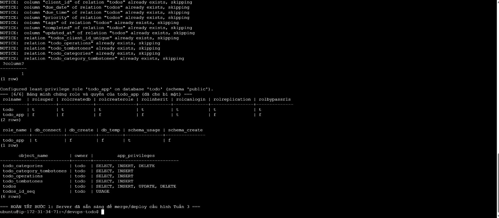

</details>

<details>
<summary>2. Bước 2 — Deploy và 7 container</summary>

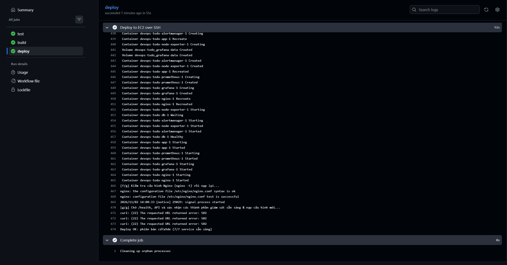

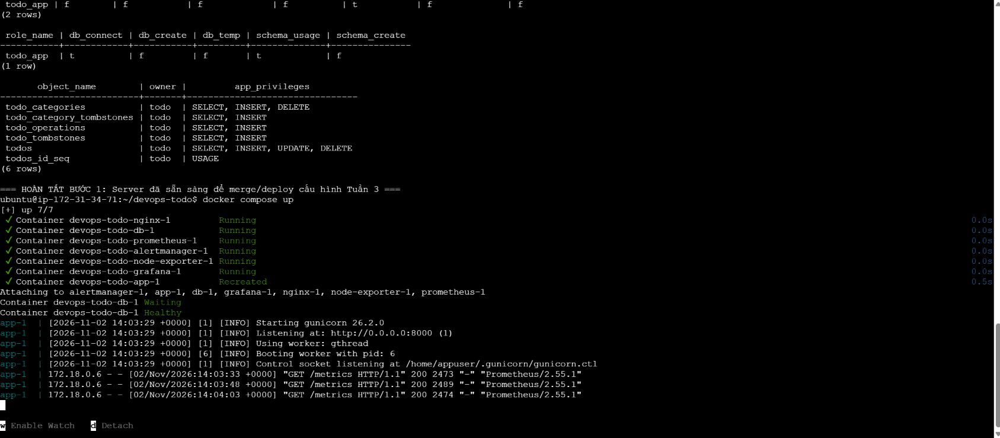

</details>

<details>
<summary>3. Bước 3 — Grafana</summary>

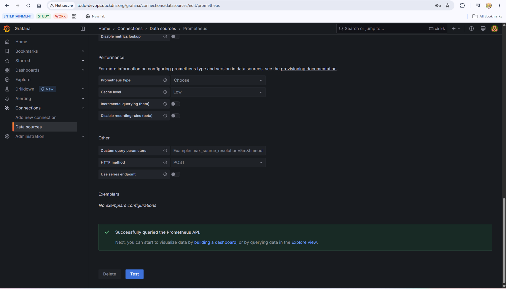

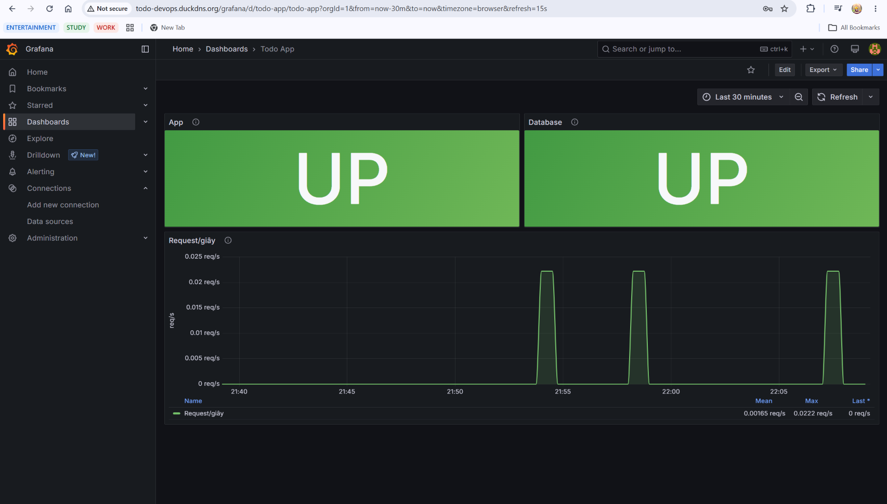

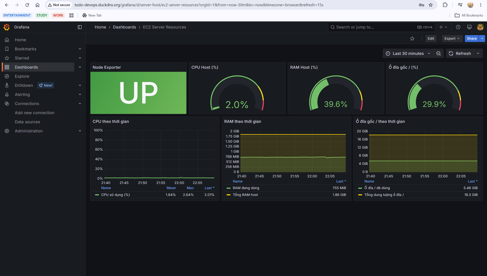

</details>

<details>
<summary>4. Bước 4 — Thử cảnh báo AppDown qua Discord</summary>

Khi app tắt, panel App chuyển `DOWN` và trang trả `502 Bad Gateway`. Panel Database báo `No data` vì số liệu này do chính app cung cấp.

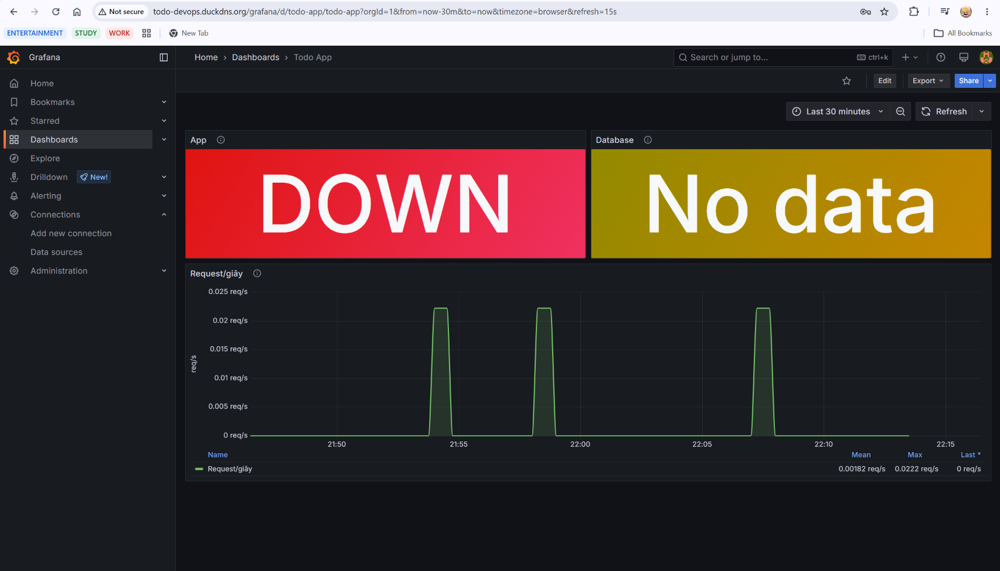

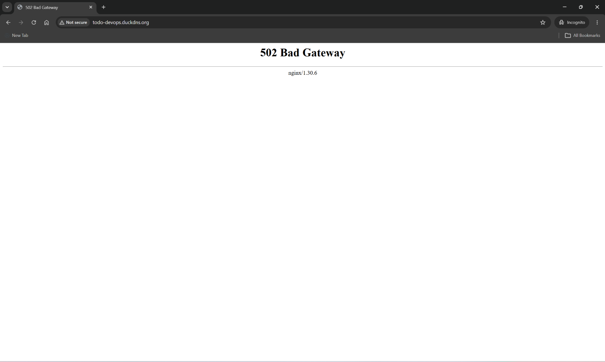

Discord nhận `[FIRING:1] AppDown` lúc 22:14 và `[RESOLVED] AppDown` lúc 22:29:

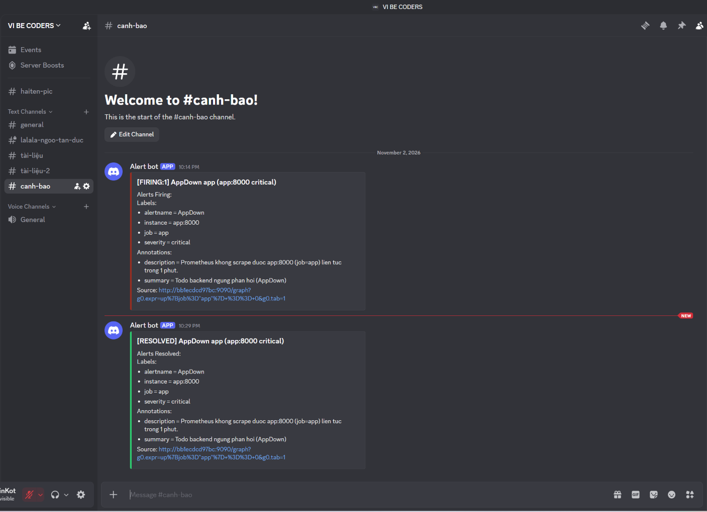

</details>

<details>
<summary>5. Bước 5 — Log</summary>

Lệnh tắt, bật app và log Nginx có dòng 502 lúc app tắt:

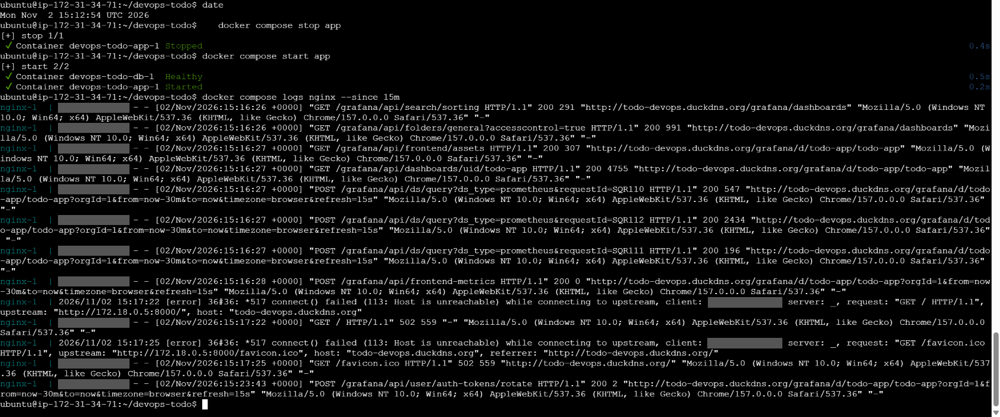

Giờ bật lại của container app và cấu hình xoay vòng log:

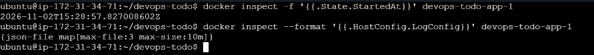

</details>

<details>
<summary>6. Bước 6 — Backup và restore</summary>

`db-check.sh` trước backup, sau khi xoá dữ liệu và sau restore; dòng `real` là thời gian restore:

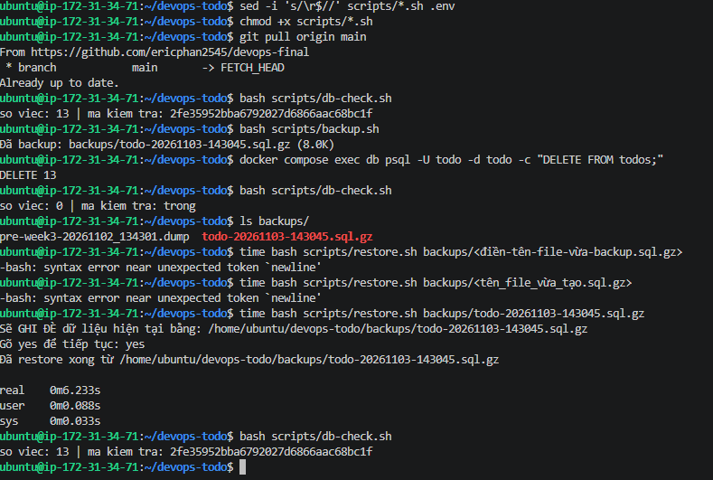

</details>

<details>
<summary>7. Bước 7 — Firewall, SSH và secrets</summary>

UFW chỉ cho phép SSH (22) và HTTP (80):

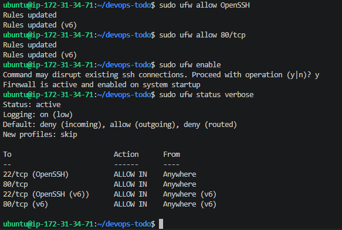

Kiểm tra cổng từ laptop: cổng 80 mở, cổng 5432 (PostgreSQL) và 3000 (Grafana) đóng:

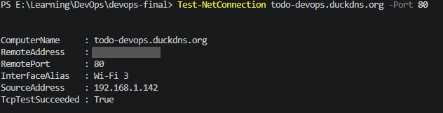

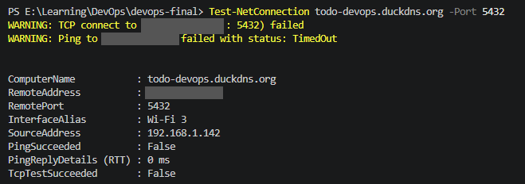

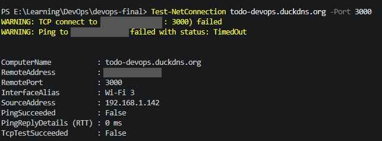

SSH chỉ cho đăng nhập bằng khoá:

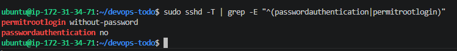

Lệnh kiểm tra Git không in dòng nào, nghĩa là repo không chứa `.env`, `secrets/` hay `backups/`:

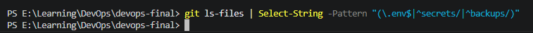

`todo_app` bị chặn khi xoá bảng, làm rỗng bảng và tạo bảng mới:

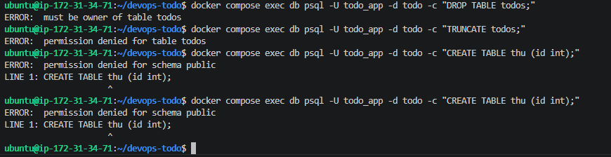

</details>

## 14. Xử lý sự cố

| Triệu chứng | Kiểm tra và cách xử lý |
| --- | --- |
| Không mở được web | Kiểm tra EC2 Running, rule HTTP 80, `docker compose ps` và đúng địa chỉ HTTP |
| Tên miền trỏ sai IP | Kiểm tra bản ghi DuckDNS và tác vụ `/usr/local/sbin/duckdns-update`; không công khai token |
| Docker báo permission denied | Kiểm tra user thuộc nhóm `docker`; đăng xuất/đăng nhập lại sau khi thêm nhóm |
| Nginx trả 502 | Xem log app/DB, kiểm tra bước migration trong `scripts/deploy.sh`; chạy `nginx -t` và reload Nginx sau khi thay container |
| DB báo sai mật khẩu | Đối chiếu `.env` với mật khẩu dùng lúc tạo volume (`POSTGRES_PASSWORD`) và mật khẩu đã cấp cho `APP_DB_USER` qua `db/app-user.sh`; không xoá volume nếu cần giữ dữ liệu |
| Lỗi `must be owner` hoặc thiếu quyền bảng | Không chạy `migrate.py` bằng `todo_app`; chạy `scripts/deploy.sh` để thực thi migration bằng `POSTGRES_USER` rồi chạy lại `db/app-user.sh` |
| Alertmanager không khởi động được | Kiểm tra `secrets/discord_webhook_url` là file thường (không phải thư mục), không rỗng và có quyền `root:65534` (`640`), thư mục `secrets` có quyền `750` |
| `/grafana/` bị vòng lặp chuyển hướng | Kiểm tra `GRAFANA_ROOT_URL` kết thúc bằng `/grafana/`, `GF_SERVER_SERVE_FROM_SUB_PATH=true` và `proxy_pass http://grafana:3000;` trong `nginx/default.conf` không có dấu `/` cắt subpath |
| CI không kết nối được DB | Kiểm tra service PostgreSQL và các biến `DB_*` / `ADMIN_DB_*` trong workflow |
| SSH invalid format/publickey | Kiểm tra toàn bộ private key trong `EC2_SSH_KEY` và key pair đúng với server |
| SSH timeout | Kiểm tra EC2, DNS, rule SSH 22 và kết nối từ runner |
| Pull không fast-forward | Xem `git status` trên server và đối chiếu thay đổi trước khi cập nhật; không tự ghi đè code |
| Script báo `$'\r'` | File `.sh` cần LF; repo có `.gitattributes` cho shell/Python/SQL/YAML/conf |
| Pipeline đỏ ở health/monitoring | Đọc thông báo giai đoạn `[a/g]`–`[g/g]` của `scripts/deploy.sh` và log service tương ứng |
| UI báo chưa đồng bộ | Kiểm tra `/health`, `/api/tasks` và trạng thái cuối trang; giữ hàng đợi để gửi lại |

## 15. Nguồn và ghi chú

App mẫu ban đầu được xây dựng với hỗ trợ AI (Claude); phần giao diện, đồng bộ và tài liệu có hỗ trợ AI (Codex). Nhóm kiểm tra, hiểu mã nguồn và chịu trách nhiệm với bản nộp. Phân công cá nhân ở mục 1 ghi theo đóng góp nhóm xác nhận.

Các thư viện Python được ghim phiên bản trong [app/requirements.txt](app/requirements.txt) và [requirements-dev.txt](requirements-dev.txt). Thiết kế ngoại tuyến tham khảo [Service Worker](https://developer.mozilla.org/en-US/docs/Web/API/Service_Worker_API) và [IndexedDB](https://developer.mozilla.org/en-US/docs/Web/API/IndexedDB_API).
