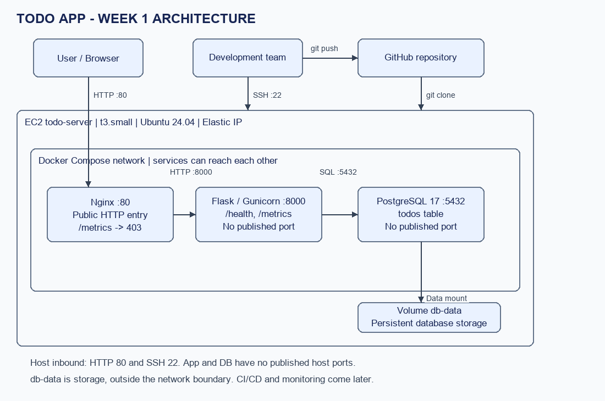

# Todo · DevOps Final Project

Không gian quản lý công việc với menu bên trái, bảng công việc theo ngày và khả năng làm việc ngoại tuyến. Giao diện lấy cảm hứng từ mẫu Organic Mind, tập trung vào nội dung công việc; phần giao diện và hệ thống được gom trong Cài đặt. Ứng dụng dùng Flask + PostgreSQL, HTML/Jinja, CSS và JavaScript thuần; không dùng CDN hoặc thư viện frontend.

## Chức năng

- Thêm và sửa công việc tối đa 200 ký tự, đếm ký tự realtime, chặn tên chỉ có khoảng trắng.
- Đặt ngày/giờ thực hiện, chọn nhanh hôm nay/ngày mai/cuối tuần.
- Ưu tiên Cao/Trung bình/Thấp; thẻ #HọcTập, #DevOps, #CáNhân.
- Đánh dấu hoàn thành, huỷ hoàn thành; hộp thoại xác nhận trước khi xoá.
- Tìm kiếm tiếng Việt có/không dấu, phím `/`, xoá nhanh từ khoá.
- Menu Sắp tới / Hôm nay / Tất cả / Lịch công việc; bộ lọc Cá nhân, DevOps và Học tập dùng các thẻ đã lưu.
- Trang Sắp tới chia riêng Hôm nay, Ngày mai và Trong tuần; việc xa hơn nằm ở Sau tuần này. Cuối tuần, nhóm còn lại chuyển thành Sau đó. Mỗi việc chỉ nằm trong một nhóm.
- Nút Thêm công việc trong từng nhóm điền sẵn ngày; việc chưa có lịch hoặc quá hạn vẫn truy cập được ở Tất cả.
- Lịch tuần và lịch tháng có chấm báo ngày có việc chưa hoàn thành.
- Sắp xếp theo ID mới/cũ, tên, ngày hẹn hoặc mức ưu tiên. Việc đã hoàn thành được đưa xuống cuối.
- Menu bên trái có thể thu gọn. Trên điện thoại, menu mở/đóng theo nhu cầu và các nhóm công việc xếp thành một cột.
- Tiến độ hôm nay hiển thị ngay trên danh sách công việc, gồm vòng phần trăm, số việc đã xong và số việc còn lại. Số liệu tính từ toàn bộ công việc được lên lịch cho hôm nay, không phụ thuộc góc nhìn hoặc bộ lọc đang chọn.
- Cài đặt chứa lựa chọn sáng/tối, trạng thái kết nối, hàng đợi, lần đồng bộ gần nhất, đồng bộ thủ công và thông tin phiên bản. Lựa chọn sáng/tối được nhớ bằng localStorage.
- IndexedDB lưu danh sách và hàng đợi; tự gửi thay đổi lên Flask khi kết nối sẵn sàng.
- Cuối danh sách hiển thị số việc cần làm và đã xong của góc nhìn hiện tại. `APP_VERSION` và tổng số việc trên thiết bị nằm trong Cài đặt.

Ứng dụng hiện là một danh sách chung; chưa có tài khoản riêng, đăng nhập, nhắc việc nền hoặc cộng tác theo thành viên.

## Cách dùng giao diện

1. Mở Sắp tới để xem công việc theo ngày, hoặc chọn Tất cả để xem cả việc chưa có lịch và quá hạn.
2. Bấm Thêm việc ở đầu trang hoặc Thêm công việc trong một nhóm. Nhập tên, đặt lịch/ưu tiên/thẻ rồi bấm Thêm. Khi chỉnh sửa, nút chuyển thành Lưu.
3. Bấm mũi tên trên dòng công việc để sửa; ô bên trái đánh dấu hoàn thành; Xoá mở hộp thoại xác nhận.
4. Tìm kiếm ở menu bên trái hoặc bấm `/` để tìm toàn bộ danh sách. Chọn một phân loại để lọc bằng thẻ; bộ đếm lấy từ dữ liệu thực.
5. Mở Cài đặt ở cuối menu để đổi giao diện, xem kết nối/hàng đợi hoặc đồng bộ thủ công. Phím Escape đóng hộp thoại.

Giao diện không có đăng nhập, đăng xuất, danh sách tuỳ tạo hoặc ghi chú dán. Những mục đó trong mẫu tham chiếu không được đưa thành nút chưa hoạt động.

## Kiến trúc



```text
Trình duyệt → Nginx :80 → Flask/Gunicorn :8000 → PostgreSQL 17 :5432
    │                                              │
    ├── IndexedDB: dữ liệu + hàng đợi                └── volume db-data
    ├── localStorage: giao diện
    └── Service Worker: bộ nhớ trang và tài nguyên
```

Chỉ Nginx publish cổng 80 ra host. App và DB giao tiếp trong mạng Compose. App chờ DB healthy trước khi chạy. `/metrics` bị Nginx chặn từ bên ngoài; `/health` kiểm tra kết nối DB.

Sơ đồ triển khai hiện có thể chưa thể hiện chi tiết mới của cơ chế ngoại tuyến; xem [thiết kế đồng bộ](docs/offline-first.md) và [file drawio](docs/architecture.drawio).

## Ngoại tuyến hoạt động thế nào?

1. Khi mở trang, ứng dụng đọc dữ liệu đã lưu trong IndexedDB và hiển thị ngay.
2. Thêm/sửa/hoàn thành/xoá được ghi vào một giao dịch IndexedDB trước khi giao diện báo đã lưu.
3. Mỗi thao tác có UUID riêng. Công việc cũng có UUID ổn định; ID PostgreSQL được hiển thị sau khi server nhận việc.
4. Ứng dụng kiểm tra `/health`, lấy `/api/tasks`, gửi tuần tự hàng đợi qua `/api/operations` rồi lấy lại danh sách.
5. Chỉ xoá một thao tác khỏi hàng đợi sau khi nhận phản hồi xác nhận. Mất phản hồi thì gửi lại cùng mã; server trả kết quả đã lưu và không thực hiện lần hai.
6. Khi không kết nối được, dữ liệu trên máy vẫn có thể tìm, lọc, sắp xếp, sửa và xoá. Công việc có thay đổi chờ gửi được đánh dấu `⏳ Chờ đồng bộ`.

Trạng thái xanh chỉ xuất hiện khi `/health` và toàn bộ vòng đối chiếu/gửi/đọc lại API thành công, đồng thời hàng đợi rỗng. Lỗi quyền truy cập, API chưa được triển khai hoặc lỗi lưu trên thiết bị không được báo là đã đồng bộ. Kết nối mạng của hệ điều hành không được dùng làm bằng chứng duy nhất.

### Điều kiện để mở lại trang khi mất mạng

Service Worker cần **HTTPS hoặc localhost**, và trang phải từng được mở thành công khi có mạng. Trên EC2 chỉ dùng HTTP với IP public, dữ liệu vẫn lưu và thao tác ngoại tuyến được khi trang đang mở, nhưng không bảo đảm tải lại toàn bộ trang khi mất mạng. Cấu hình Nginx trong repo hiện vẫn là HTTP; cần triển khai HTTPS để dùng đầy đủ khả năng này trên EC2.

Service Worker cache trang/CSS/JS, không cache `/health`, `/api/*` hoặc request POST. Đồng bộ chạy khi ứng dụng đang mở hoặc được mở lại; chưa có cơ chế gửi nền khi đóng hẳn trình duyệt.

Bộ nhớ gắn với origin (giao thức, host, cổng) và trình duyệt. Đổi IP lab sẽ tạo origin khác. Không xoá dữ liệu website khi còn thay đổi chưa đồng bộ. Nếu IndexedDB bị chặn/đầy, ứng dụng báo không lưu được thay vì giả báo đã đồng bộ.

## Cấu trúc

```text
app/
  app.py                    # Form gốc, API và endpoint Service Worker
  migrate.py                # Migration bổ sung, giữ dữ liệu hiện có
  schema.sql                # Schema chuẩn
  entrypoint.sh             # Migration trước khi chạy Gunicorn
  Dockerfile
  requirements.txt
  templates/index.html      # Jinja và form không cần JavaScript
  static/
    style.css
    app.js                  # Lịch, bộ lọc, IndexedDB và đồng bộ
    service-worker.js       # Cache trang, bỏ qua API/POST
db/init.sql                # Cùng schema cho DB mới
nginx/default.conf
scripts/setup-server.sh
scripts/deploy.sh
tests/test_app.py            # Kiểm thử PostgreSQL trong schema riêng
tests/offline.test.cjs       # Kiểm thử logic hàng đợi bằng Node.js
docs/offline-first.md
docs/architecture.*
docs/evidence/
docker-compose.yml
requirements-dev.txt
pytest.ini
README.md
```

## Chạy trên máy cá nhân

Yêu cầu: Git, Docker Engine và Docker Compose plugin; trên Windows dùng Docker Desktop với Linux containers.

```bash
git clone https://github.com/ericphan2545/devops-final.git
cd devops-final
```

Tạo `.env` từ `.env.example`. Trong PowerShell:

```powershell
Copy-Item .env.example .env
```

Trong Linux/macOS/Git Bash:

```bash
cp .env.example .env
```

Mở `.env`, đổi `POSTGRES_PASSWORD` trước lần tạo DB đầu tiên. Không commit mật khẩu thật.

```bash
docker compose config --quiet
docker compose up -d --build
docker compose ps
```

Mở `http://localhost`. Khi Service Worker đã chuẩn bị xong bộ nhớ trang, có thể tắt mạng và tải lại để thử.

## Nâng cấp từ bản tuần 1

Bản này thay đổi cả frontend, Flask, Dockerfile và schema; không chỉ thay ba file UI.

- `entrypoint.sh` chạy `migrate.py` trước Gunicorn.
- Migration thêm cột lịch/giờ, ưu tiên, thẻ, hoàn thành, UUID và bảng nhật ký thao tác/tombstone.
- Migration có khoá giao dịch, có thể chạy lại; không drop/truncate bảng hoặc xoá dữ liệu cũ.
- Các công việc cũ được cấp UUID. `client_id` có default PostgreSQL để writer cũ chỉ ghi title vẫn hoạt động.
- Sửa `db/init.sql` không tự cập nhật volume DB cũ; migration trong app là bước áp dụng thay đổi cho volume đó.

Nên sao lưu DB trước khi nâng cấp. Sau khi lấy đầy đủ các file mới, chạy `docker compose up -d --build`. Không dùng `down -v` để đổi giao diện hoặc nâng schema.

## Triển khai EC2

Bản Flask dùng API và PostgreSQL thật. Link Sites xem thử trước đây là môi trường mô phỏng riêng; không tự kết nối vào EC2. Xem [hướng dẫn bật đồng bộ thật](docs/production-sync.md) để chạy đúng bản ứng dụng.


Server chạy 24/7 trên tài khoản AWS riêng của nhóm (gói Free, vùng Sydney ap-southeast-2):
Ubuntu 24.04, t3.small, ổ 20 GiB, mở HTTP 80 và SSH 22.
Địa chỉ: http://todo-devops.duckdns.org

Dựng server mới: dán `scripts/setup-server.sh` vào EC2 User data, điền `DUCKDNS_TOKEN` ở đầu
(token xem ở duckdns.org, không commit). Script cài Docker, clone repo vào `~/devops-todo`, tạo `.env`,
chạy Compose và tự báo IP cho DuckDNS (lúc khởi động và mỗi 5 phút),
nên secret `EC2_HOST` (= `todo-devops.duckdns.org`) không phải sửa khi IP đổi.
Xem log bằng `sudo tail -f /var/log/setup-server.log` (chỉ root đọc được vì có mật khẩu và token).

Mỗi lần push/merge vào main, GitHub Actions tự test, build và deploy. Muốn deploy tay, trên server:

```bash
cd ~/devops-todo
git switch main
git pull --ff-only origin main
bash scripts/deploy.sh
```

Script gắn `APP_VERSION`, build/chạy app, reload Nginx và kiểm tra health. Nếu chạy Compose trực tiếp không đặt phiên bản, Cài đặt hiển thị `dev`. Deploy health lỗi chưa tự rollback.

Nếu muốn cài thủ công, cài Docker/Compose, clone repo vào `~/devops-todo`, tạo `.env` rồi chạy `bash scripts/deploy.sh`. Các file `.sh` cần xuống dòng LF.

## Progressive Enhancement

Không có JavaScript:

- Jinja hiển thị công việc từ PostgreSQL.
- Form `POST /add` nhận `title`, `due_date`, `due_time`, `priority`, `tags`.
- Form `POST /delete/<id>` xoá công việc.
- Form `POST /complete/<id>` thay đổi trạng thái hoàn thành.

Các chức năng ngoại tuyến, lịch tương tác, tìm kiếm tại chỗ và modal cần JavaScript. Khi tắt JavaScript, form xoá gửi POST trực tiếp và không có modal xác nhận.

## API đồng bộ

| Endpoint | Vai trò |
| --- | --- |
| `GET /health` | Kiểm tra kết nối DB |
| `GET /api/tasks` | Danh sách cùng metadata và UUID |
| `POST /api/operations` | Một thao tác create/update/delete có op_id và client_id |
| `GET /service-worker.js` | Script cache có scope toàn origin |

Các API và health dùng `Cache-Control: no-store`. Server lưu kết quả theo `op_id` trong cùng giao dịch với thay đổi dữ liệu. Gửi cùng mã nhưng khác payload nhận HTTP 409. Tombstone ngăn các thao tác cũ tạo lại việc đã xoá.

Thay đổi cùng trường từ nhiều thiết bị dùng quy tắc giá trị được server nhận sau cùng thắng. Chỉ các trường có trong bản cập nhật được ghi đè; xoá có ưu tiên hơn cập nhật cũ. Ngày/giờ được hiểu theo giờ địa phương của trình duyệt, chưa có cấu hình múi giờ riêng cho workspace.

## Kiểm tra

```bash
curl http://localhost/health
curl -I http://localhost/metrics
docker compose logs app --tail 30
docker compose logs nginx --tail 30
```

Mong đợi health trả `{"status":"ok"}`, metrics qua Nginx trả 403, DB healthy. Trên PowerShell có thể cần `curl.exe`.

Kiểm tra thủ công:

1. Thêm việc có lịch, ưu tiên, thẻ; sửa lịch, đánh dấu hoàn thành; kiểm tra lịch và tiến độ.
2. Tìm bằng chữ không dấu, đổi các góc nhìn và cách sắp xếp.
3. Tắt mạng: thêm/sửa/xoá, xác nhận nhãn chờ đồng bộ và hàng đợi tăng.
4. Trên localhost/HTTPS đã cache, tải lại trong lúc mất mạng; dữ liệu và hàng đợi phải còn.
5. Bật mạng: chờ nhãn đồng bộ xanh; tải lại và kiểm tra PostgreSQL không có việc trùng.
6. Thử huỷ xoá bằng Giữ lại/Escape; thử trên điện thoại và cả hai theme.

### Chạy test tự động

Dùng DB kiểm thử riêng. Ví dụ:

```bash
docker run -d --name todo-test-db -p 127.0.0.1:55432:5432 -e POSTGRES_USER=todo -e POSTGRES_PASSWORD=testpass -e POSTGRES_DB=todo_test postgres:17
python -m pip install -r requirements-dev.txt
```

Chờ `docker exec todo-test-db pg_isready -U todo -d todo_test` báo sẵn sàng. Trong PowerShell:

```powershell
$env:DB_HOST = "localhost"
$env:PGPORT = "55432"
$env:DB_NAME = "todo_test"
$env:DB_USER = "todo"
$env:DB_PASSWORD = "testpass"
python -m pytest -v
node tests/offline.test.cjs
```

Test tạo schema PostgreSQL ngẫu nhiên riêng và dọn schema đó khi xong. Test Node.js kiểm tra thêm việc chia nhóm ngày không trùng lặp (kể cả cuối tuần và giao năm), góc nhìn Sắp tới bao gồm hôm nay và lọc theo thẻ. Ngoài bốn test cơ bản còn có metadata, migration giữ dữ liệu cũ, gửi lại/concurrent replay, tombstone, validation, form và Service Worker endpoint.

## Dữ liệu và lab

Volume `db-data` giữ dữ liệu khi tạo lại container trên cùng host, không bảo vệ khi host/ổ đĩa bị xoá. `docker compose down -v` xoá dữ liệu DB. Đổi `.env` không tự đổi mật khẩu trong DB đã được tạo.

Server không còn dùng lab AWS Academy (lab xoá sạch tài nguyên sau mỗi phiên). Nếu phải tạo server hoặc key mới, chỉ cần cập nhật secret `EC2_SSH_KEY`; `EC2_HOST` giữ nguyên nhờ DuckDNS. Backup DB trước khi xoá server.

## CI/CD và phạm vi tuần 2

Đã có Docker/Compose, script deploy, migration, test backend và test logic ngoại tuyến. `requirements-dev.txt` đã có dependencies.

Workflow `.github/workflows/ci-cd.yml` chưa có trong snapshot gốc và không được thêm trong bản nâng cấp UI này. Secrets và minh chứng pipeline cần hoàn thiện riêng theo yêu cầu tuần 2: test → build → deploy, chặn deploy khi test lỗi, kiểm tra dữ liệu còn sau deploy và đo ba lần chạy.

## Thành viên và minh chứng

Phân công tuần 1 giữ theo README trước; cập nhật phần việc mới theo đóng góp thực tế.

| Thành viên | MSSV | Phần việc tuần 1 |
| --- | --- | --- |
| Phan Tiến Thịnh | 23090023 | Repo, app mẫu, EC2, Docker, triển khai và setup-server.sh |
| Ngô Tấn Đức | 23090008 | Dockerfile, Compose, môi trường, Nginx, sơ đồ và README |
| Đặng Vĩnh Quang | 23090005 | Chưa ghi nhận trong README trước |
| Huỳnh Hữu Như Mẫn | 23090020 | Chưa ghi nhận trong README trước |

- [EC2](docs/evidence/ec2-running.png), [Security Group](docs/evidence/security-group.png), [Docker](docs/evidence/docker-version.png).
- [Compose](docs/evidence/compose-up-ps.png), [health/metrics](docs/evidence/health-metrics.png), [health public IP](docs/evidence/health-public-ip.png).
- [Giao diện cũ](docs/evidence/app-web.png), [video cũ](docs/evidence/demo.mp4), [down/up](docs/evidence/compose-down-up.png).

Các ảnh này thuộc bản trước, không chứng minh tính năng ngoại tuyến mới. Cần chụp lại giao diện, hàng đợi và quá trình kết nối lại sau khi triển khai.

Nguồn app ban đầu được hỗ trợ bởi AI (Claude); phần giao diện, đồng bộ và tài liệu được hỗ trợ bởi AI (Codex). Nhóm kiểm tra và chịu trách nhiệm với bản nộp.

Nguồn kỹ thuật: [Service Worker và điều kiện HTTPS/localhost](https://developer.mozilla.org/en-US/docs/Web/API/Service_Worker_API), [IndexedDB và giao dịch dữ liệu](https://developer.mozilla.org/en-US/docs/Web/API/IndexedDB_API).

Demo CI/CD: cập nhật tài liệu lần 2.